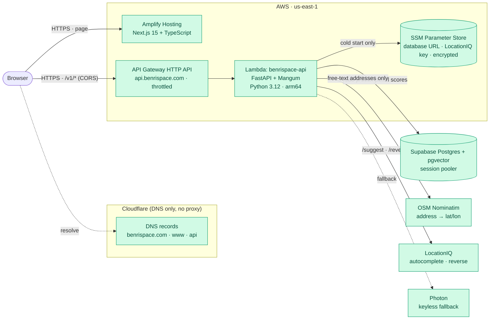
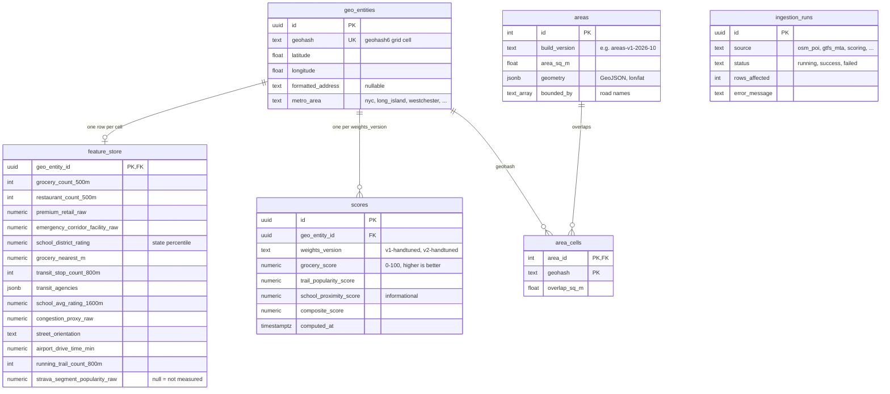
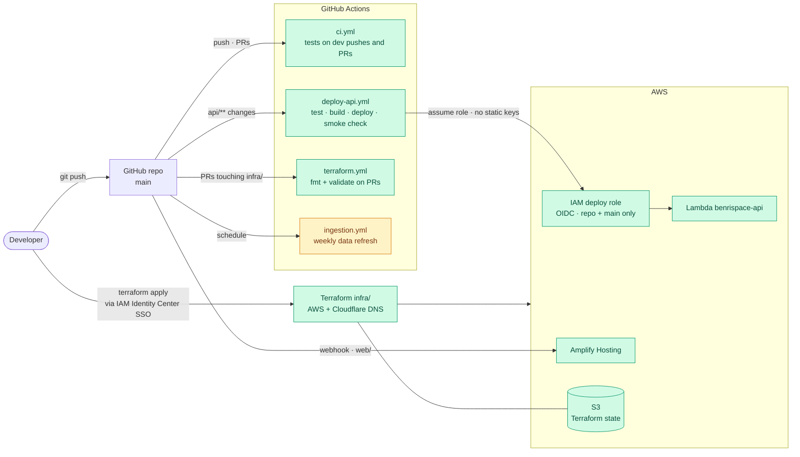

# BenriSpace — Architecture

BenriSpace scores NYC-metro locations on how convenient daily life is there
(groceries, transit, schools, trails, noise corridor, airports…) using 14
factors. Scores are **precomputed in batch** and served read-only, so live
traffic never touches a rate-limited third-party API (address search and
reverse lookups are the only live provider calls, and they are cached).

Diagrams are [Mermaid](https://mermaid.js.org/) and render on GitHub.

**Status legend:** green = built and running · amber = code merged and deployed
(or written and tested) but its data or output is not live yet. Planned work is
listed in section 5.

**Where things stand (2026-10-02).** The v2 code (14 factors, road-bounded
areas, miles, Home/App site) is merged and deployed, and migrations `0002_v2`
and `0003_areas` are applied to production. The v2 data ingestion and the
Lambda `SCORING_WEIGHTS_VERSION` cutover from `v1-handtuned` to `v2-handtuned`
are still in progress, so until then the new factors show "No data" and
production keeps serving v1 scores. Area polygons are built and loaded (16,277
areas, 101,540 area-to-cell mappings).

## 1. Runtime — how a request is served

- **Endpoints:** `GET /v1/score`, `GET /v1/score/{id}/explanation`,
  `GET /v1/area`, `GET /v1/suggest`, `GET /v1/reverse`, `GET /v1/map/cells`,
  `GET /v1/map/top` and `POST /v1/triangulate` — defined in
  `contracts/openapi.yaml`, which is also the source for the frontend's
  generated TypeScript types. Full guide: `docs/api.md`.
- **Click-to-polygon.** `/v1/area` finds the road-bounded polygon containing the
  point (tables `areas` + `area_cells`) and returns the area-weighted average of
  the overlapping cells' latest scores. It returns 404 when no polygon fits (or
  one is larger than 10 sq mi), and the web app then falls back to the single
  cell rectangle.
- **Serving version.** Score reads prefer the Lambda's `SCORING_WEIGHTS_VERSION`
  (default `v1-handtuned` until the v2 cutover).
- **Explanation** and **triangulate** are placeholders today (a template
  sentence and a straight-line-distance circle, bbox-prefiltered in SQL) until
  the RAG layer and the routing engine land.
- **Not on the request path:** scoring. Requests only read the `scores`,
  `areas` and `area_cells` tables.

## 2. Data pipeline — how scores are produced

```mermaid
flowchart LR
  cron(["GitHub Actions<br/>weekly cron · Mon 06:00 UTC"])
  grid["grid_generation<br/>64,320 geohash6 cells"]

  subgraph jobs["Ingestion jobs · run one at a time · one source query per metro area"]
    poi["osm_poi<br/>groceries · gyms · cafes · restaurants · bars<br/>gas · convenience · Whole Foods/Starbucks/Target<br/>source: OSM Overpass"]
    roads["roads<br/>congestion · noise corridor<br/>fire/hospital/police locations<br/>source: OSM Overpass"]
    trails["trails<br/>running route popularity (underlying)<br/>source: OSM Overpass + optional Strava enrichment (not configured)"]
    transit["gtfs_transit<br/>stops by agency<br/>source: MTA · LIRR · Metro-North feeds"]
    schools["schools<br/>count · distance · district rating<br/>source: NCES + EDFacts (Urban Institute)"]
    airports["airports<br/>drive time (straight-line unless routing is configured)<br/>JFK · LGA · EWR hardcoded"]
  end

  fs[("feature_store<br/>raw counts + distances")]
  score["scoring.run<br/>normalize per metro<br/>weighted composite"]
  scores[("scores<br/>versioned by weights_version")]
  log[("ingestion_runs<br/>per-job status log")]
  abuild["ingestion.areas.build<br/>manual run, not in the weekly cron<br/>road-bounded areas from OSM"]
  areas[("areas + area_cells<br/>16,277 areas · 101,540 mappings")]

  cron --> grid --> jobs --> fs --> score --> scores
  jobs -.-> log
  abuild --> areas
  areas -. "area-weighted avg of cell scores, at request time" .-> scores

  classDef live fill:#d1fae5,stroke:#059669,color:#064e3b
  classDef pending fill:#fef3c7,stroke:#d97706,color:#78350f
  class grid,trails,transit,airports,fs,log,abuild,areas live
  class poi,roads,schools,score,scores pending
```

- Amber nodes are the v2 additions whose data run is still in progress
  (restaurants, bars and brands in `osm_poi`; the facility-aware noise corridor
  in `roads`; NCES schools and ratings; the `v2-handtuned` scoring run). The
  weekly workflow (`.github/workflows/ingestion.yml`) runs grid, then the
  sources one after another (airports, schools, gtfs_transit, osm_poi, roads,
  trails), then scoring. Sequential because every job updates the same
  `feature_store` rows and held row locks otherwise time out. The `schools` job
  needs the `.[schools]` pip extra (shapely, pyshp).
- Area polygons are rebuilt by hand
  (`python -m ingestion.areas.build --source region --write`; Overpass tiles are
  cached and fetching needs `--allow-network`). They are not part of the weekly
  workflow. A stage-1 prototype of 5-10 block neighborhood clusters lives in
  `ingestion/areas/` but is not wired into scoring.
- Each job queries a source **once per metro area** and computes per-cell
  results locally — never one request per cell.
- Jobs degrade independently: a missing NJ Transit key (not obtained yet) or an
  Overpass timeout fails one job and its `ingestion_runs` row, not the
  pipeline. Strava is not configured, so running route popularity comes from
  mapped OSM trails alone.
- Writes go through one shared DB layer that pipelines statements; bookkeeping
  writes use a separate connection so a failure can always be recorded.
- Scoring normalizes each factor *within its metro cohort* (so suburbs aren't
  flattened against Manhattan), flips negative factors, and takes a weighted
  average. The v2 school score is 20% proximity and 80% district rating, and
  NULL when unrated. Full rationale: `contracts/normalization.md`.
- Scores are relative within each metro cohort, and area scores are averages of
  ~0.6 x 0.4 mi cells, so small areas share similar scores until per-polygon
  scoring exists.

## 3. Data model

`feature_store` has about 40 raw columns in total; only a representative set is
shown. A `null` raw value always means "not measured yet", never "zero".
`area_cells.geohash` is a plain text join to `geo_entities.geohash`, not a
foreign key. Migrations `0002_v2.sql` and `0003_areas.sql` in
`contracts/migrations/` are applied to production by hand.

## 4. Delivery — how code and infrastructure ship

- Amber `ingestion.yml` is the weekly job whose v2 run (and its scoring step
  writing `v2-handtuned` rows) is still in progress. Changing the version the
  API serves is a Terraform variable (`scoring_weights_version`) applied by
  hand after that run.
- No long-lived AWS keys exist anywhere: CI uses OIDC, the developer uses SSO.
- The database URL lives only in SSM; Terraform writes a placeholder and never
  sees the real value.
- The API zip is cross-built for Linux arm64 / Python 3.12 from any host, so
  local and CI builds match.

## 5. Planned (not built)

| Phase | Addition | What it replaces today |
| --- | --- | --- |
| 2 | Valhalla routing engine on a small EC2 instance | straight-line-circle placeholder in `/triangulate`; straight-line airport drive times |
| 3 | RAG layer (LLM over retrieved scores) + pgvector "similar neighborhoods" | template-based explanation |
| 4 | Google sign-in (Supabase Auth), Free/Pro/Business tiers, rate limits, Stripe | unauthenticated API |
| 5 | Commute-aware scoring, rent overlay, orchestrator | single metro on cron |
| Later | Neighborhood clusters of 5-10 blocks scored per polygon (instead of averaged grid cells) | area scores averaged from ~0.6 x 0.4 mi cells; some sliver areas; water not clipped |

Nationwide expansion is not planned; the product covers the NYC metro only.
Other known gaps: school ratings are district-level only, NJ Transit's key has
not been obtained, and Strava is not configured.

## Key design decisions

- **Precompute, don't compute live.** Scoring is batch; the API is a thin read
  layer. This keeps latency low (~0.2 s warm) and cost near zero.
- **One grid, many independent jobs.** Every source writes into the same
  geohash grid, so sources can fail, retry and be added without touching each
  other.
- **Contract first.** `contracts/openapi.yaml` and `contracts/schema.sql` were
  fixed before any code that depends on them; the frontend types are generated
  from the spec.
- **Infrastructure as code, single cloud.** Everything on AWS, all of it in
  Terraform; DNS stays at Cloudflare because the registrar requires it.
- **Honest missing data.** Unmeasured factors are `null` end to end — the
  scorer re-weights around them and the UI shows "No data" instead of 0.
