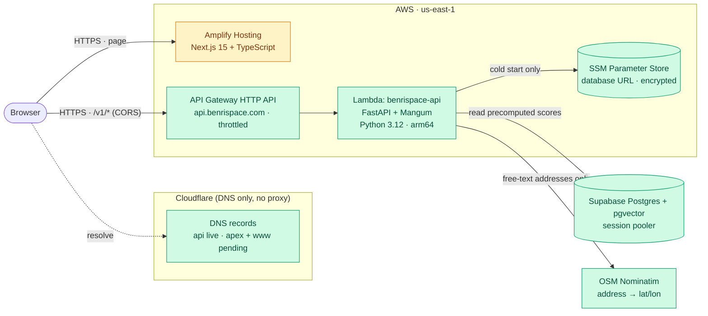
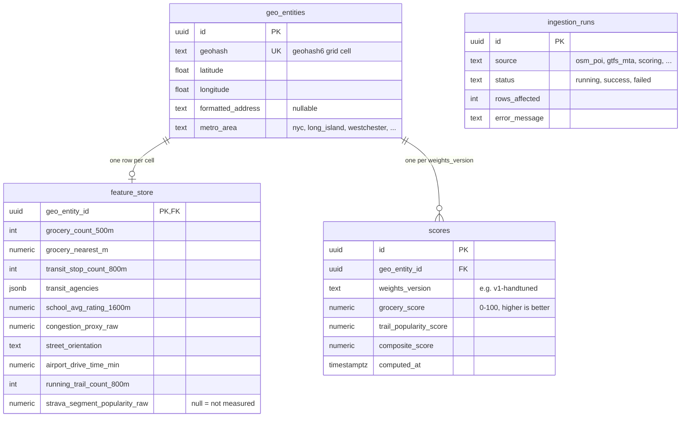
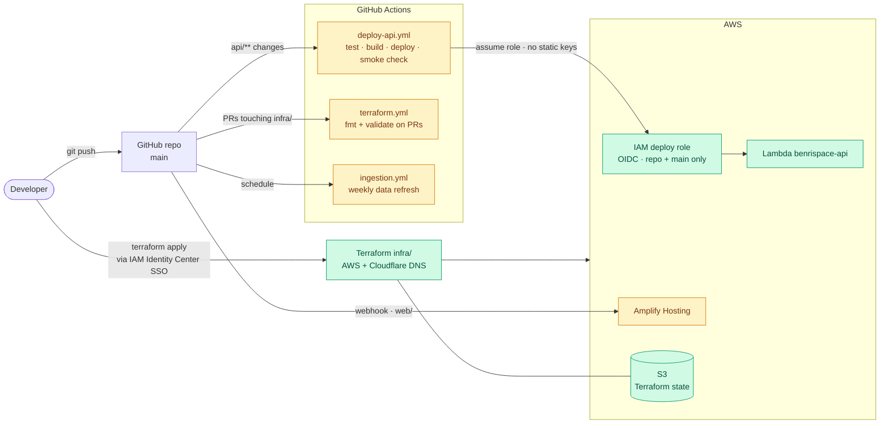

# BenriSpace — Architecture

BenriSpace scores NYC-metro locations on how convenient daily life is there
(groceries, transit, schools, trails, road noise, airports…). Scores are
**precomputed in batch** and served read-only, so live traffic never touches a
rate-limited third-party API.

Diagrams are [Mermaid](https://mermaid.js.org/) and render on GitHub.

**Status legend:** green = built and running · amber = written and tested but
never run in production yet. Planned work is listed in section 5.

## 1. Runtime — how a request is served

- **Endpoints:** `GET /v1/score`, `GET /v1/score/{id}/explanation`,
  `POST /v1/triangulate` — defined in `contracts/openapi.yaml`, which is also
  the source for the frontend's generated TypeScript types.
- **Explanation** and **triangulate** are placeholders today (a template
  sentence and a straight-line-distance circle) until the RAG layer and the
  routing engine land.
- **Not on the request path:** scoring. Requests only read the `scores` table.

## 2. Data pipeline — how scores are produced

```mermaid
flowchart LR
  cron(["GitHub Actions<br/>weekly cron · Mon 06:00 UTC"])
  grid["grid_generation<br/>64,320 geohash6 cells"]

  subgraph jobs["Ingestion jobs · run in parallel · one source query per metro area"]
    poi["osm_poi<br/>groceries · gyms · cafes · gas · convenience<br/>source: OSM Overpass"]
    roads["osm_roads<br/>congestion · corridor noise<br/>source: OSM Overpass"]
    trails["trails<br/>running paths<br/>source: OSM Overpass + optional Strava"]
    transit["gtfs_transit<br/>stops by agency<br/>source: MTA · LIRR · Metro-North feeds"]
    schools["schools<br/>count · distance · attendance<br/>source: NYC Open Data"]
    airports["airports<br/>drive time<br/>JFK · LGA · EWR hardcoded"]
  end

  fs[("feature_store<br/>raw counts + distances")]
  score["scoring.run<br/>normalize per metro<br/>weighted composite"]
  scores[("scores<br/>versioned by weights_version")]
  log[("ingestion_runs<br/>per-job status log")]

  cron --> grid --> jobs --> fs --> score --> scores
  jobs -.-> log

  classDef live fill:#d1fae5,stroke:#059669,color:#064e3b
  class grid,poi,roads,trails,transit,schools,airports,score,fs,scores,log live
```

- Each job queries a source **once per metro area** and computes per-cell
  results locally — never one request per cell.
- Jobs degrade independently: a missing NJ Transit key or an Overpass timeout
  fails one job and its `ingestion_runs` row, not the pipeline.
- Writes go through one shared DB layer that pipelines statements; bookkeeping
  writes use a separate connection so a failure can always be recorded.
- Scoring normalizes each factor *within its metro cohort* (so suburbs aren't
  flattened against Manhattan), flips negative factors, and takes a weighted
  average. Full rationale: `contracts/normalization.md`.

## 3. Data model

`feature_store` has about 26 raw columns in total; only a representative set is
shown. A `null` raw value always means "not measured yet", never "zero".

## 4. Delivery — how code and infrastructure ship

- No long-lived AWS keys exist anywhere: CI uses OIDC, the developer uses SSO.
- The database URL lives only in SSM; Terraform writes a placeholder and never
  sees the real value.
- The API zip is cross-built for Linux arm64 / Python 3.12 from any host, so
  local and CI builds match.

## 5. Planned (not built)

| Phase | Addition | What it replaces today |
| --- | --- | --- |
| 2 | Valhalla routing engine on a small EC2 instance | straight-line-circle placeholder in `/triangulate`; straight-line airport drive times |
| 3 | RAG layer (LLM over retrieved scores) + pgvector "similar neighborhoods" | template-based explanation |
| 4 | Google sign-in (Supabase Auth), Free/Pro/Business tiers, rate limits, Stripe | unauthenticated API |
| 5 | Commute-aware scoring, rent overlay, multi-metro, orchestrator | single metro on cron |

## Key design decisions

- **Precompute, don't compute live.** Scoring is batch; the API is a thin read
  layer. This keeps latency low (~0.2 s warm) and cost near zero.
- **One grid, many independent jobs.** Every source writes into the same
  geohash grid, so sources can fail, retry and be added without touching each
  other.
- **Contract first.** `contracts/openapi.yaml` and `contracts/schema.sql` were
  fixed before any code that depends on them; the frontend types are generated
  from the spec.
- **Infrastructure as code, single cloud.** Everything on AWS, all of it in
  Terraform; DNS stays at Cloudflare because the registrar requires it.
- **Honest missing data.** Unmeasured factors are `null` end to end — the
  scorer re-weights around them and the UI shows "No data" instead of 0.
