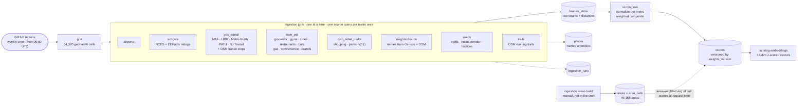
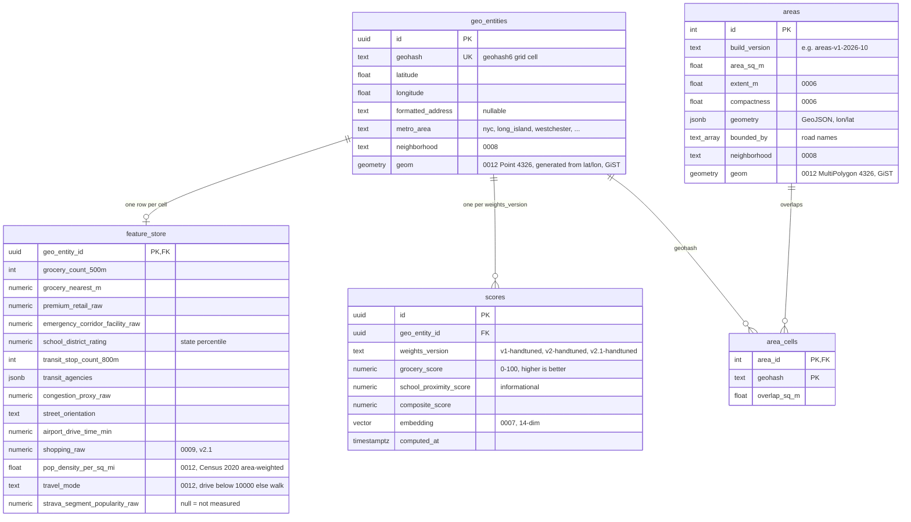
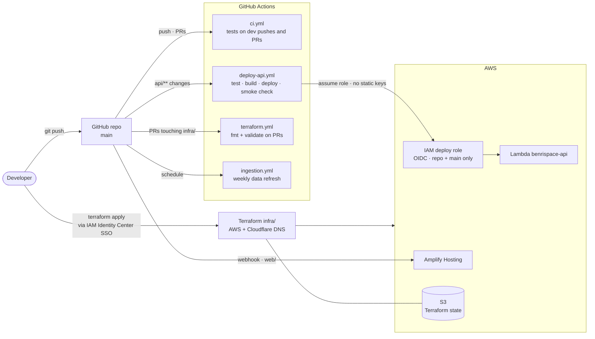

# BenriSpace — Architecture

BenriSpace scores New York metro locations on how convenient daily life is there
(groceries, transit, schools, parks, noise, airports...) using 13 factors. Scores
are **precomputed in batch** and served read-only, so live traffic never touches a
rate-limited third-party data API. The only live provider calls are address
search, reverse lookups, the optional routing refinement and the LLM, and all of
those are cached or capped.

Related documents: [../README.md](../README.md) (overview and quick start),
[SCORING.md](SCORING.md) (how scores are computed), [ROADMAP.md](ROADMAP.md)
(phases, status and decisions), [api.md](api.md) (API guide),
[data-sources.md](data-sources.md) (school data decisions).

Diagrams are [Mermaid](https://mermaid.js.org/) and render on GitHub.

**State as of 2026-10-04.**

- Production serves `v2-handtuned` (14 factors, 64,320 score rows; the Lambda runs
  `SCORING_WEIGHTS_VERSION=v2-handtuned`). Cutover was 2026-10-03.
- `v2.1-handtuned` (13 factors) is built. Migration 0009 is applied; the full
  ingestion for its new columns is in progress, and the cutover waits for owner
  approval.
- Neighborhood names (migration 0008) are applied. Areas are capped at 0.8 sq mi
  and there are 49,158 of them.
- Chat ("Ask Benri", `POST /v1/chat`) is in progress; migration 0010 is not
  applied yet.
- Valhalla routing precompute and the v3 scoring model are planned, not built.

## 1. Runtime: how a request is served

### API endpoints

All under `/v1`, defined in `contracts/openapi.yaml` (the source of the web
app's generated TypeScript types) and implemented in `api/main.py`. Full guide:
[api.md](api.md).

| Endpoint | Purpose |
| --- | --- |
| `GET /score` | Score for an address or coordinate (grid cell) |
| `GET /score/{id}/explanation` | Explanation of a score (AI-written when possible, rule-based otherwise) |
| `GET /area` | Score for the road-bounded area under a point (area-weighted average of its cells) |
| `GET /area/explanation` | Grounded explanation for the area under a point |
| `GET /suggest` | Address autocomplete (LocationIQ, Photon fallback) |
| `GET /reverse` | Readable address for a clicked point |
| `GET /places` | Named places (OSM POIs, NCES schools, transit stops) near a point |
| `GET /improve` | Deterministic "what would raise this score" suggestions with named places |
| `GET /similar` | Well-separated areas with a similar factor profile (pgvector) |
| `GET /map/cells` | Composite score per map cell for a chosen set of factors and weights |
| `GET /map/top` | Best, well-separated areas for the chosen factors (with neighborhood names) |
| `POST /triangulate` | Best locations for several commute anchors (placeholder geometry, see below) |
| `POST /optimize` | Multi-destination optimizer: minimise weekly travel to work, a store brand, a gym... |
| `POST /chat` | "Ask Benri", a tool-using Haiku assistant (in progress) |

Behavior worth knowing:

- **Click-to-polygon.** `/area` finds the road-bounded polygon containing the
  point (`areas` + `area_cells`) and returns the area-weighted average of the
  overlapping cells' latest scores. It returns 404 when no polygon fits (over
  0.8 sq mi or 1.4 mi across, or none contains the point), and the web app then
  falls back to the single cell rectangle.
- **Point precision (experimental).** `?precision=point` on `/score` and `/area` scores
  the exact location on demand: one pipelined round trip (cell row plus one PostGIS
  statement over `places`), normalized with per-metro factor scales (`score_scales`,
  migration 0013, or computed once per Lambda instance). Falls back to the grid score on
  any error. See [SCORING.md](SCORING.md) A8.
- **Serving version.** Score reads prefer the Lambda's `SCORING_WEIGHTS_VERSION`.
  The code default is `v2-handtuned`; production sets it through the Terraform
  variable `scoring_weights_version`. Roll back by setting it to
  `v1-handtuned` and applying.
- **Neighborhood names.** `geo_entities.neighborhood` and `areas.neighborhood`
  (migration 0008); the API tolerates the columns being absent (the name is then
  null).
- **Triangulate** is live but uses a placeholder geometry (straight-line distance
  circle, bbox-prefiltered in SQL) until Valhalla lands.
- **Optimize** estimates minutes (straight line x 1.3 / mode speed) for every
  candidate cell, then refines the best candidates with openrouteservice for
  walk and drive (`common/ors.py`, best-effort, free tier). Transit stays an
  estimate.
- **Not on the request path:** scoring and ingestion. Requests read `scores`,
  `areas`, `area_cells`, `places` and the caches.

## 2. Data pipeline: how scores are produced

- The weekly workflow (`.github/workflows/ingestion.yml`) runs the grid, then
  the sources one after another (airports, schools, gtfs_transit, osm_poi,
  osm_retail_parks, neighborhoods, roads, trails), then `scoring.run` and
  `scoring.embeddings`. It runs sequentially because every job updates different
  columns of the same `feature_store` rows and a job's transaction holds those
  row locks until commit; in parallel they hit Postgres' 2-minute
  `statement_timeout`. Scoring runs even if one source failed (stale values
  persist; the red job still surfaces the failure). The `schools` job needs the
  `.[schools]` pip extra (shapely, pyshp).
- **Each job queries a source once per metro area** and computes per-cell results
  locally, never one request per cell. The shared Overpass client retries a fast
  502/503/504 with backoff and lets a slow one reach the bbox-splitting that
  roads, trails, osm_poi and osm_transit use.
- **Jobs degrade independently**: an Overpass timeout fails one job and its
  `ingestion_runs` row, not the pipeline. Strava is not configured, so the route
  popularity signal comes from mapped OSM trails alone.
- **Writes** go through one shared DB layer (`common/db.py`) that wraps every
  connection in psycopg3 pipeline mode (this dropped airport ingestion from more
  than 3 minutes and zero rows to 5.9 s for all 64,320 rows). Bookkeeping writes
  use a separate connection so a failure can always be recorded.
- **Transit coverage.** MTA, LIRR, Metro-North, PATH (public Trillium feed) and
  NJ Transit (open official rail and bus downloads, no key or account) are
  separate per-agency jobs inside `gtfs_transit`. `ingestion/osm_transit.py`
  adds OpenStreetMap stops as a pseudo-agency to fill gaps (CT, Westchester and
  Long Island buses, areas near PATH).
- **Schools.** NCES EDGE locations for NY/NJ/CT plus EDFacts district
  proficiency (2018) from the Urban Institute Education Data Portal, converted to
  within-state percentiles. See [data-sources.md](data-sources.md).
- **Trails lessons.** An early tag selection captured ordinary sidewalks
  (`highway=footway` without excluding `footway=sidewalk|crossing`); excluding
  them server-side cut NYC from 1,173,871 to 326,522 segments. Bucket-index
  lookups expand rings instead of falling back to a brute-force scan (the
  fallback took 921 s for 4,029 cells).
- **Areas** are rebuilt by hand (`python -m ingestion.areas.build --source region
  --write`; Overpass tiles are cached, fetching needs `--allow-network`). They
  are a face of the network of secondary-and-above roads closed at the coast,
  cut to the limits in `ingestion/areas/limits.py`: at most 0.8 sq mi and 1.4 mi
  across, about 0.75 mi tile cuts, slivers under 0.02 sq mi merged into a
  neighbour when the caps allow. Apply migration 0006 before `--write`. Product
  rule: "your 10-minute radius dictates your life", so an area is about a
  square mile at most. Secondary roads and above are hard barriers (owner
  decision).
- **Neighborhood names** (`ingestion/neighborhoods.py`): Census TIGER/Line county
  subdivisions say which town a point is in (a label never crosses a river or
  state line); OSM `place=neighbourhood|suburb|quarter` nodes supply the
  names, giving labels like "Park Slope, Brooklyn" or "Montclair, NJ".
- **Places** (`places` table): one row per named amenity (OSM POIs, NCES schools,
  GTFS stops). Each job owns its `source` and replaces it wholesale. Powers
  `/places` and `/improve`.
- **Similar areas**: `scoring.embeddings` writes a 14-dim z-scored vector per
  scored cell into `scores.embedding`; `/similar` does nearest-neighbour search
  with pgvector, spread out geographically, re-ranked on the selected factors.
- Scores are relative within each metro cohort in v1/v2/v2.1, and area scores are
  averages of about 0.6 x 0.4 mi cells, so small areas share similar scores
  until per-polygon scoring exists.

## 3. Data model

Other tables: `ingestion_runs` (per-job status log: source, status, rows
affected, error), `places` (named amenities, 0004), `llm_cache` and `llm_usage`
(0005), `chat_usage` (0010), and `road_segments` (0012, not applied: `osm_id`, `highway`, `name`, `is_emergency_route`, `geom` LineString 4326 with a GiST index; major roads and mainline rail). `places.geom` (Point 4326, GiST) is added by 0012 too. The geometry columns are not used by any API query yet.

`feature_store` has dozens of raw columns; only a representative set is shown. A
`null` raw value always means "not measured yet", never "zero".
`area_cells.geohash` is a plain text join to `geo_entities.geohash`, not a
foreign key. `contracts/schema.sql` is the full schema for a fresh database; each
migration is mirrored into it.

### Migrations

Migrations live in `contracts/migrations/` and are run by hand against production
after review (additive and idempotent, so old code keeps working).

| # | Adds | Status |
| --- | --- | --- |
| 0002 `v2` | v2 feature_store columns (restaurants, bars, brands, noise-corridor facilities, school rating) | applied 2026-10-02 |
| 0003 `areas` | `areas`, `area_cells` | applied 2026-10-02 |
| 0004 `places` | named `places` table | applied 2026-10-03 |
| 0005 `llm` | `llm_cache`, `llm_usage` | applied 2026-10-03 |
| 0006 `area_shape` | `areas.extent_m`, `areas.compactness` | applied 2026-10-03; written by the area build (49,158 areas at 0.8 sq mi) |
| 0007 `embeddings` | pgvector extension, `scores.embedding vector(14)`, HNSW index | applied 2026-10-03; 64,320 embeddings written by `scoring.embeddings` |
| 0008 `neighborhoods` | `neighborhood` on `geo_entities` and `areas` | applied 2026-10-04 |
| 0009 `v2_1` | v2.1 feature_store and scores columns (imperial units) | applied 2026-10-04 |
| 0010 `chat` | `chat_usage` (per-visitor daily message count) | not applied; the API skips the limit while the table is missing |
| 0012 `density_postgis` | PostGIS; `feature_store.pop_density_per_sq_mi` and `travel_mode`; `geom` on `geo_entities`, `places`, `areas` with GiST indexes; `road_segments` | not applied; written by `ingestion.density` and `ingestion.road_segments` |

## 4. Scoring engine

Full method in [SCORING.md](SCORING.md). Summary:

| Version | `weights_version` | Factors | State |
| --- | --- | --- | --- |
| v1 | `v1-handtuned` | 11 | history only (rows kept for rollback) |
| v2 | `v2-handtuned` | 14 (12 toggleable + premium retail and trail popularity as underlying signals) | **live in production** |
| v2.1 | `v2.1-handtuned` | 13, every one a user-facing pill | built; full ingestion in progress; cutover pending owner approval |
| v3 | `v3-timeaccess` | 13+ | planned: absolute time-to-access curves, mode by density |

`scoring/engine.py` holds the per-version category specs and weights (`DEFAULT_WEIGHTS`,
`V2_1_WEIGHTS`); `scoring/run.py` writes versioned rows and nulls stale columns;
`scoring/embeddings.py` builds the similarity vectors.

## 5. AI layer

- **Model.** Anthropic Haiku 4.5 (`claude-haiku-4-5`) only, through
  `common/llm.py`. Decided 2026-10-03.
- **RAG, not fine-tuning.** The data changes constantly, and retrieval
  constrains the model to what is in the evidence. A hallucinated "great coffee
  shop nearby" is a trust-breaking failure for this product.
- **Grounding.** The model sees only a JSON evidence packet (the user's
  priorities, sub-scores, nearest-feature distances, how each factor compares
  with the metro). Output is validated; on any failure the rule-based
  explanation (`api/explain.py`) is returned. Explanations: `api/ai_explain.py`,
  prompt version `expl-v2`. Chat (`api/chat.py`) can only call read-only tools
  that run our own code in-process; structured results and sources are built
  deterministically from tool outputs, and the free-text reply passes a grounding
  validator (numbers and capitalised proper nouns must appear in tool outputs or
  the user's messages) or is replaced by a deterministic summary.
- **Budget.** `llm_cache` stores validated responses keyed by a hash of the
  evidence (entity, weights_version, scores, prompt version) so an area is paid
  for once. `llm_usage` logs every paid call; month-to-date spend at or above
  `LLM_MONTHLY_BUDGET_USD` (default $5) switches to rule-based text. Chat adds a
  per-visitor daily message cap (15, table `chat_usage`) and returns 503 without
  an API key.
- **Evaluation scripts:** `scripts/eval_explanations.py`, `scripts/eval_chat.py`.

## 6. Routing and optimizer

- **Today.** Minutes are estimated: straight-line distance x 1.3 circuity /
  mode speed (walk 3 mph; drive 20 mph in dense cells, 30 mph in suburban
  cells). `/optimize` takes anchors (an address such as work, a brand such as
  Trader Joe's, a category such as gym) with trips per week and minimises
  `sum(tripsPerWeek x 2 x minutes)` over candidate cells, using the nearest
  matching place per anchor; the top candidates are refined with openrouteservice
  (40 matrix calls per minute on the free tier). Airport drive time in ingestion
  is straight-line until routing exists (the Valhalla call is wired behind
  `VALHALLA_URL`).
- **Planned (decided).** Precompute walk/drive/transit minutes per cell with
  Valhalla in a batch run: on a laptop with Docker (Docker and Colima are
  installed locally) or a short-lived AWS spot instance. Valhalla, not OSRM,
  because it has native isochrones. Invert the expensive direction: compute from
  the 2-4 user anchors, not per candidate address. Live triangulation from
  arbitrary addresses would use a hosted routing free tier. Transit minutes need
  Valhalla with GTFS.

## 7. Delivery: how code and infrastructure ship

- **Branches.** All work happens on `dev-benrispace`; `main` changes only through
  a pull request, because merging to `main` triggers the Amplify build (every
  push) and `deploy-api.yml` (changes to `api/`, `common/`, `scoring/`,
  `pyproject.toml`). `ci.yml` diffs against `main` and runs the Python and/or web
  checks only for changed areas; **`ci-ok`** is the single status to require.
  Batching several changes into one PR means one deploy instead of many.
- **Terraform** (`infra/`, plus `infra/bootstrap/` for the S3 state bucket)
  manages every AWS resource and every Cloudflare DNS record: Lambda
  (`python3.12`, arm64), API Gateway HTTP API (throttled 10 rps, burst 20), ACM
  certificates, the `api.benrispace.com` custom domain, Amplify app and domain,
  SSM parameters, the GitHub OIDC provider and deploy role, and a $10/month
  budget alert. `terraform apply` is deliberately manual (AWS SSO). Not yet
  applied: the Valhalla EC2 instance.
- **No long-lived AWS keys** exist anywhere: CI uses OIDC, the developer uses SSO.
  The database URL and API keys live only in SSM; Terraform writes placeholders
  and never sees the real values.
- **Operational lessons.**
  - Amplify built from a private repo needs the console's "Migrate to our GitHub
    App" step; a personal token alone broke builds once revoked. For a rebuild:
    create the app with a short-lived token, migrate immediately, revoke the
    token.
  - GitHub issues the OIDC `sub` claim with immutable IDs
    (`repo:owner@id/repo@id:ref:...`); the IAM trust matches that form
    (`github_owner_id`, `github_repository_id`), which also resists rename or
    transfer impersonation.
  - Use the Supabase **Session pooler** connection string: the direct host is
    IPv6-only and fails from IPv4-only places (this sandbox, GitHub runners).
  - The `execute-api.amazonaws.com` address is disabled
    (`disable_execute_api_endpoint = true`); `api.benrispace.com` is the only
    entry point.
- The API zip is cross-built for Linux arm64 / Python 3.12 from any host
  (`scripts/build_lambda.sh`), so local and CI builds match.

## 8. Hosting, domain and costs

- **Domain** `benrispace.com` (registered 2026-09-28 at Cloudflare Registrar).
  DNS stays at Cloudflare (the registrar requires its nameservers); Terraform
  manages every record as DNS-only so AWS certificates validate end to end.
  `benrispace.com` and `www` go to Amplify; `api.benrispace.com` goes to API
  Gateway.
- **Why AWS, everything.** Switched from GCP on 2026-09-29, and the frontend moved
  off Firebase the same day. Not a cost decision (free tiers are comparable); AWS
  has broader market and resume recognition, which matters because the project
  doubles as a portfolio piece. The original reason for GCP (co-locating
  Valhalla) turned out not to require it.
- **Why Lambda + API Gateway.** Lambda scales to zero and its always-free
  allowance (1M requests + 400,000 GB-s per month) covers this traffic. A bare
  Function URL does not support custom domains, so API Gateway HTTP API (about
  $1 per million requests) sits in front.
- **Why Next.js on Amplify.** React/TypeScript is the most in-demand frontend
  stack; Amplify gives git-push deploys and per-branch previews while keeping the
  stack single-cloud.
- **Storage.** Supabase free tier (Postgres + pgvector, about 180 MB of 500 MB
  used after the v2 scores); no separate vector database.
- **Costs.** Close to $0/month: domain (about $12-20 a year), Supabase and Lambda
  free tiers, GitHub Actions free minutes, free data sources (OSM, GTFS, NCES,
  EDFacts). Real items: API Gateway pennies, Amplify per build-minute
  (about $0.01) and GB served, Terraform state in S3 (effectively $0), and the
  LLM, capped at about $5/month. AWS restructured its free tier for new
  accounts in 2025 (starting credits plus a set of always-free offers such as
  Lambda); EC2 for Valhalla would draw down credits then bill normally, so budget
  a few dollars a month if it is ever run continuously. A card on file is an AWS
  signup requirement, and the $10 budget alert guards against surprises.
- **Request limits** exist to protect that cost budget: API Gateway throttles at
  10 rps with bursts of 20 across all callers; per-user tiers come in Phase 4
  (see [ROADMAP.md](ROADMAP.md)).

## 9. Key design decisions

- **Precompute, don't compute live.** Scoring is batch; the API is a thin read
  layer. Latency is about 0.2 s warm and cost near zero.
- **One grid, many independent jobs.** Every source writes into the same geohash
  grid, so sources can fail, retry and be added without touching each other.
- **Contract first.** `contracts/openapi.yaml` and `contracts/schema.sql` were
  fixed before code that depends on them; the web types are generated from the
  spec.
- **Infrastructure as code, single cloud.** Everything on AWS in Terraform; DNS at
  Cloudflare because the registrar requires it.
- **Honest missing data.** Unmeasured factors are `null` end to end: the scorer
  re-weights around them and the UI shows "No data" instead of 0.
- **GitHub Actions for orchestration.** Enough for a weekly cadence; Airflow or
  Dagster only if multiple metros with different refresh cadences justify it.
- **Imperial units on the wire and in the UI** (feet and miles; the API's newer
  columns are imperial). Older raw columns are still metres, and renaming them is
  planned (see [ROADMAP.md](ROADMAP.md)).
