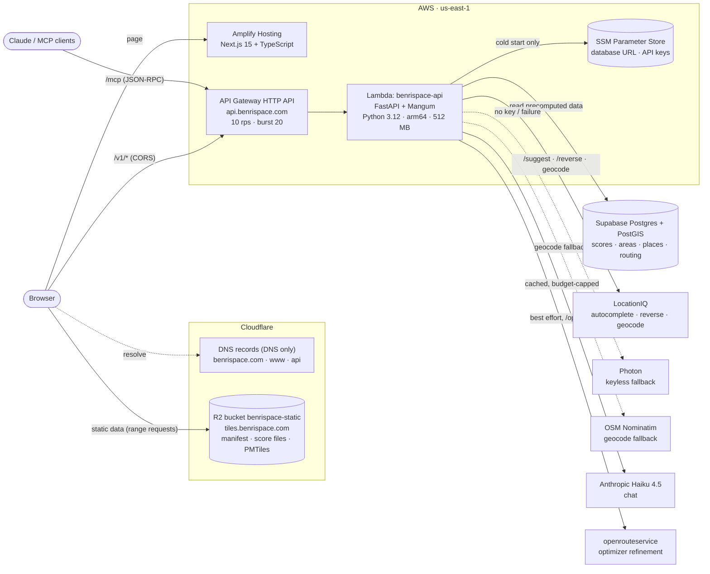
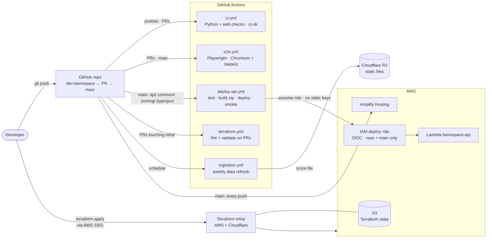

# BenriSpace — Architecture

BenriSpace scores New York metro locations on how convenient daily life is there
(groceries, transit, schools, parks, noise, airports...) using 13 factors. Scores
are **precomputed in batch** and served read-only, so live traffic never touches a
rate-limited third-party data API. The only live provider calls are address
search, reverse lookups, the optional routing refinement and the LLM, and all of
those are cached or capped.

Related documents: [../README.md](../README.md) (overview and quick start),
[SCORING.md](SCORING.md) (how scores are computed), [ROADMAP.md](ROADMAP.md)
(phases, status and decisions), [PLANNED.md](PLANNED.md) (backlog), [api.md](api.md)
(API guide), [data-sources.md](data-sources.md) (data sources and licences).

Diagrams are [Mermaid](https://mermaid.js.org/) and render on GitHub.

**State as of 2026-10-11.**

- Production serves `v2.2-density` (13 factors, scored once per road-bounded area from
  routed travel times on one absolute scale for the whole region; [SCORING.md](SCORING.md)
  A10). Cutover was 2026-10-06. The `v2.1-handtuned` rows are kept as the rollback.
- Migrations 0002 to 0023 are applied. The database is 292 MB of the 500 MB Supabase free
  tier.
- Production has 64,320 grid cells, 35,943 road-bounded areas (`areas_slim`) and the routed
  travel tables for the whole region (`cell_travel`, `cell_graph`, `cell_hubs`,
  `rail_matrix`).
- The score file, the per-area score file and the vector tiles are served from Cloudflare R2.
- Live: Ask Benri chat (it can set up the searched place, points of interest and their overlap
  on the map), the MCP connector for Claude, travel-time overlap with points of interest, and
  the Login and Pricing pages (UI only: no auth or payments yet).
- Not applied: chat streaming infrastructure and the Cloudflare edge cache. Planned: scoring
  v3, automating the monthly v2.2 refresh, auth and tiers.

## 1. Runtime: how a request is served



### Inside the Lambda

- **Entry point.** `api/lambda_handler.py` resolves the database URL and the LocationIQ,
  Anthropic and openrouteservice keys from SSM on a cold start, then wraps the FastAPI app
  (`api/main.py`) with Mangum (`lifespan="off"`). A missing database URL fails the cold start
  loudly; a missing optional key turns that feature off and the rest keeps working.
- **Routes are thin.** Each handler in `api/main.py` calls a module that holds the logic;
  request and response models are in `api/schemas.py` (camelCase on the wire) and match
  `contracts/openapi.yaml`, from which the web app's TypeScript types are generated.
- **Database connections.** `common/db.py`'s `api_connection()` keeps a small locked pool per
  Lambda instance (`API_DB_POOL_SIZE`, default 4), because a new Supabase connection costs about
  200 ms. Each request gets its own transaction; idle connections are pinged before reuse. On the
  transaction pooler (port 6543) prepared statements are turned off.
- **In-process caches** (5 minutes, about a warm instance's life): the area under a point and its
  scores (`api/area_cache.py`), suggestion and reverse lookups (`api/suggest.py` TTL LRU), the
  per-factor metro distributions (`api/metro_stats.py`, once per instance) and the score file
  (`score_files` row, rebuilt only when missing).
- **Runtime writes** are small: `feedback`, `chat_usage` (per-visitor daily chat cap), `llm_usage`
  and `llm_cache` (LLM spend and cached replies) and `score_files`. Everything else is written by
  offline jobs.

### API endpoints

All under `/v1`, defined in `contracts/openapi.yaml` and implemented in `api/main.py`. Full
guide: [api.md](api.md).

| Endpoint | Purpose | Module |
| --- | --- | --- |
| `GET /score` | Score for an address or coordinate (grid cell; `?precision=point` scores the exact spot) | `lookup.py`, `point_score.py` |
| `GET /score/{id}/explanation` | Rule-based explanation of a score | `explain.py` |
| `GET /area` | Score for the road-bounded area under a point | `slim_areas.py`, `area_scores.py`, `area_cache.py` |
| `GET /area/explanation` | Rule-based explanation for the area under a point | `areas.py` |
| `GET /suggest` | Address autocomplete (LocationIQ, Photon fallback) | `suggest.py` |
| `GET /reverse` | Readable address for a clicked point | `reverse.py` |
| `GET /places` | Named places (OSM POIs, NCES schools, transit stops) near a point | `places.py` |
| `GET /improve` | "What would raise this score" suggestions with named places | `improve.py` |
| `GET /similar` | Well-separated areas with a similar factor profile | `similar.py`, `metro_stats.py` |
| `GET /map/cells` | Composite score per map cell for chosen factors and weights | `mapdata.py` |
| `GET /map/top` | Best, well-separated areas for the chosen factors, with names | `mapdata.py` |
| `GET /map/scores` | The compact all-cells score file the browser scores from | `scorefile.py` |
| `GET /isochrone` | Area reachable from a point in N minutes (walk, drive, train) | `isochrone.py`, `reach.py`, `routing_data.py` |
| `POST /triangulate` | Best places inside the overlap (or union) of several anchors' travel-time areas | `triangulate.py`, `isochrone.py` |
| `POST /optimize` | Multi-destination optimizer: minimise weekly travel to work, a store brand, a gym... | `optimize.py` |
| `POST /chat` | "Ask Benri", a tool-using Haiku assistant; may return a map `plan` | `chat.py` |
| `POST /chat/stream` | The same chat as server-sent events (`status` frames, then `reply` or `error`) | `chat.py`, `stream_server.py` |
| `GET /sources` | Data sources and their last ingestion runs | `sources.py` |
| `POST /feedback` | Thumbs up/down and comments from the web app | `feedback.py` |
| `POST /mcp` (also `/v1/mcp`) | MCP connector: Claude calls BenriSpace's tools over JSON-RPC | `mcp.py` |

Behavior worth knowing:

- **Serving version.** Score reads use the Lambda's `SCORING_WEIGHTS_VERSION`, set by the
  Terraform variable `scoring_weights_version` (default `v2.2-density`). Roll back by setting it
  to `v2.1-handtuned` and republishing the v2.1 static files.
- **Click-to-polygon.** `/area` finds the smallest `areas_slim` polygon containing the point
  (`ST_Contains` on a GiST index; a point on a road snaps to the nearest polygon within 40 m).
  For a density version it returns the stored `area_scores` row (migration 0023); for older
  versions it scores sample points on demand. It returns 404 when no polygon fits, and the web
  app then falls back to the grid cell.
- **Point precision.** `?precision=point` on `/score` scores the exact location on demand: one
  pipelined round trip (cell row plus one PostGIS statement over `places`), normalized with
  per-metro factor scales (`score_scales`). Falls back to the grid score on any error. The web
  app builds with `NEXT_PUBLIC_SCORE_PRECISION=point`. See [SCORING.md](SCORING.md) A8.
- **Isochrones and triangulate** run on the precomputed cell graph (section 6): Dijkstra in pure
  Python over the `cell_graph` rows around the origin, the polygon traced from the reached cells.
  `intersect` and `union` are exact set operations on those cells, and the ranking reads the
  scores inside. An anchor with no routing data falls back to a straight-line circle
  (`method: "estimate"`).
- **Optimize** seeds with a geometric median, prunes with exact lower bounds, reads stored times
  (`cell_travel`, `cell_hubs`, `rail_matrix`) and refines the survivors with openrouteservice for
  walk and drive (`common/ors.py`, best effort). Estimates (straight line x 1.3 / mode speed) are
  the fallback.
- **Chat plans.** When `optimize_location` anchors on an address and brands or categories, the
  chat response carries a `plan` (the address as the searched place, up to two stops as points
  of interest). The web app hydrates them and shows the overlap. The MCP connector strips the
  plan, since it is web-only.
- **Not on the request path:** scoring, ingestion and routing precompute.

### The web app

`web/` is Next.js 15 (App Router) with React 19, TypeScript, CSS modules and MapLibre GL.
Pages: `/` (Home), `/app` (the workspace), `/map`, `/data` (sources), `/docs` (API docs),
`/settings`, `/pricing` and `/login`. Pricing and Login are UI only.

- **Workspace.** `components/Workspace.tsx` holds the search box, score card, map and the
  phone bottom sheet. The searched place's travel toggle sits inside the search box
  (`MainTravel`, state in `hooks/useMainTravel.ts`); each point of interest has its own
  (`TripPlanner`, `hooks/useTripPlanner.ts`). Toggles show the mode icon with the minutes in a
  small badge (`TravelBadge`). Every mode starts at 10 minutes; the steppers stop at walk 30,
  train 45 and drive 60. The searched place's panel holds the "Show on map" switch for its
  travel boundary (`hooks/useMainReach.ts` loads `GET /isochrone`); `TripLegend` explains the
  pink line ("Within 10 min by car") whenever it is drawn. The two POI boxes sit in one
  non-wrapping row at any width; their place names ellipsize.
- **Travel-time overlap.** Points of interest (work, a gym, family) each get a travel-time area
  from `POST /triangulate`, and the best areas are ranked inside the overlap. Once per new set of
  places, `tuneTravel` (`lib/travel.ts`) tunes travel per place: the searched place keeps its mode
  and minutes (it is the place visited most), each point of interest starts there and gets the
  fewest extra minutes to overlap it (and the other point of interest), moving to the next faster
  mode (`widerTravel`) only past its mode's maximum. If the overlap is empty and the user has not
  changed anything, `widenPlan` widens the point of interest farthest from the searched place,
  up to two steps. While a new travel time loads for the same places, the previous overlap stays
  on screen (dimmed, `refreshing`) so the panel does not collapse and jump.
- **Pins stay on land.** `POST /triangulate` over-fetches ranked cells and moves each onto the
  nearest road-bounded area (`slim_areas.snap_to_land`, one KNN query on the `areas_slim` GiST
  index), dropping cells more than 0.35 mi from any area (open water). The map redraws basemap
  piers above its water layer (`lib/map/waterMask.ts`) so places on a pier show on land.
- **Map focus.** The map flies to a single pin, or fits all pins, when a pin is clicked, an
  address is scored, a point of interest is added, or an overlap, best or similar area is picked.
  With an overlap pick open, a map tap clears the pick instead of moving the searched place.
- **Scoring in the browser.** The app downloads the score file once (`lib/scores/`): every
  cell's 13 sub-scores as bytes. The overall score is a weighted average, so the browser
  recomputes it for any filter or importance change, recolours the map and ranks areas with no
  API call. `localTop` (`lib/scores/topk.ts`) picks well-separated best areas with a max-heap and
  a grid hash. Names come from the API only for cells not yet named.
- **Static files from R2** (`NEXT_PUBLIC_STATIC_URL`, `lib/static/`): `manifest.json` lists the
  score file, the per-area score file and the PMTiles archive. Each piece is optional, and any
  failure means "ask the API as before". The area file gives instant area scores on a click
  (replaced by `GET /area` when it answers) and browser-side similar areas (`lib/static/similar.ts`,
  mirroring `api/similar.py`).
- **Vector tiles.** The cell grid and area polygons are drawn from one PMTiles file
  (`scripts/build_tiles.py`, tippecanoe in Docker): layers `parents` (geohash-5, z5-9), `cells`
  (geohash-6, z10-13) and `areas` (z9-13), geometry and ids only. Scores join by geohash through
  MapLibre feature-state (`components/map/usePmtilesCells.ts`). GeoJSON cells are the fallback.
- **Compare places.** Pin 2-4 places (`useCompare`, `sessionStorage`); `CompareDrawer` shows
  them side by side with the biggest differences.
- **Chat.** Ask Benri (`components/chat/ChatPanel.tsx`) loads lazily, offers starter questions
  built from the selected factors and trip context, and passes any returned `plan` to the
  workspace (`applyChatPlan`). Streaming is used only when `NEXT_PUBLIC_CHAT_STREAM_URL` is set.

### Chat streaming (built, not applied)

API Gateway buffers responses, so `POST /chat/stream` frames only arrive live through a Lambda
function URL in `RESPONSE_STREAM` mode. `infra/chat_stream.tf` defines that second function (same
zip, uvicorn behind the AWS Lambda Web Adapter via `api/run_stream.sh` and `api/stream_server.py`).
It is off (`chat_stream_enabled = false`). The reply itself is never streamed token by token: it is
checked against the tool output first. Owner steps: remove `uvicorn` from `EXCLUDED_DEPENDENCIES`
in `scripts/build_lambda.sh`, set `chat_stream_enabled = true` and
`chat_stream_adapter_layer_arn`, apply, then set `NEXT_PUBLIC_CHAT_STREAM_URL` to the
`chat_stream_url` output plus `v1/chat/stream`. The function URL shares the per-visitor daily
limit and monthly budget with `/chat`.

### Static files on R2 (`benrispace-static`)

Static data is served from a private Cloudflare R2 bucket behind
`https://tiles.benrispace.com`, so the browser does not call the API for it. Everything is
content-addressed and immutable except the manifest:

| Key | Content | Headers |
| --- | --- | --- |
| `manifest.json` | the pointer to the current files, written LAST | `Cache-Control: public, max-age=60`, `application/json` |
| `scores/<version>.<sha12>.bin` | the `GET /map/scores` body (`api/scorefile.py`, format 1) | `max-age=31536000, immutable`, gzip `Content-Encoding`, `application/octet-stream` |
| `areas/<version>.<sha12>.bin` | every road-bounded area's centroid, name, metro and 13 sub-scores (`api/areafile.py`, format 1) | same as scores |
| `tiles/benrispace.<sha12>.pmtiles` | the vector tiles, uploaded raw (range requests) | `immutable`, `application/vnd.pmtiles`, no `Content-Encoding` |

`sha12` is the first 12 hex characters of the SHA-256 of the UNCOMPRESSED bytes. The manifest:

```json
{"format": 1, "weightsVersion": "v2.2-density", "generatedAt": "2026-10-06T16:00:00+00:00",
 "scores":     {"path": "scores/v2.2-density.<sha12>.bin", "bytes": 1234567, "sha256": "<hex>"},
 "areaScores": {"path": "areas/v2.2-density.<sha12>.bin",  "bytes": 1234567, "sha256": "<hex>"},
 "tiles":      {"path": "tiles/benrispace.<sha12>.pmtiles", "bytes": 1234567, "sha256": "<hex>"}}
```

Any of the three may be absent; paths are relative to the manifest; `bytes` is the
uncompressed size. A republish merges with the manifest already in the bucket, so entries
that are not rebuilt stay (scores and areaScores of a different weights version are dropped).

**areaScores format 1** (little-endian): `uint32 header_length`; header JSON padded with
spaces so `4 + header_length` is a multiple of 4: `{"format":1,"kind":"areaScores",
"version","factors":[13 keys],"count":N,"generatedAt","metros":[...],"names":[...]}`; then
`N*4` uint32 area ids (ascending), `N*4` int32 centroid latitude x 1e5, `N*4` int32 centroid
longitude x 1e5, `N*2` uint16 index into `names` (65535 = none), `N*1` uint8 index into
`metros` (255 = none), `N*13` uint8 sub-scores area-major (0-100, 255 = none). Trailing
bytes are ignored. For `v2.2-density` the scores are the `area_scores` rows; for older versions
they are what `GET /area?precision=point` returns (`scripts/build_area_scores.py`). The
centroid is `ST_PointOnSurface` of the area polygon.

The weekly ingestion job republishes the score file (`--scores-only`). The v2.2 score and area
files and the tiles are published by hand (section 2).

#### Runbook: R2 static files

Credentials (`R2_ACCESS_KEY_ID`, `R2_SECRET_ACCESS_KEY`, `R2_ACCOUNT_ID`) and `DATABASE_URL`
come from `.env`; the build only reads production. Run from the repo root with the venv.

```bash
# once: CORS (GET/HEAD, Range, the site origins and localhost:3000)
python scripts/publish_static.py --setup-bucket

# v2.2: score and area files straight from the database
python scripts/publish_static.py --weights-version v2.2-density

# tiles (needs the local DB to hold scored cells and areas_slim, and Docker)
export PATH=$HOME/.local/bin:$PATH; colima start; docker start benri-postgis
python scripts/build_tiles.py --out build/tiles

# publish: plan first, then for real; the manifest is uploaded last
python scripts/publish_static.py --dry-run --tiles build/tiles/benrispace.pmtiles
python scripts/publish_static.py --tiles build/tiles/benrispace.pmtiles
python scripts/publish_static.py --scores-only   # what CI runs: only the score file

# housekeeping: list, then delete, unreferenced objects older than 7 days
python scripts/publish_static.py --prune
python scripts/publish_static.py --prune --yes
```

Uploads only happen for keys `head_object` reports missing, so reruns are cheap. To check a
publish, fetch `manifest.json` and one file with boto3 and decode it (`api.areafile.decode`,
or the decoder in `docs/api.md` for scores).

#### Simplified polygons in Postgres

Production `areas_slim` holds simplified outlines only (Douglas-Peucker at 3e-5 degrees, about
3 m, snapped to a 1e-5 degree grid, made valid); the PMTiles carry the full detail. The local
build table keeps the 1e-5 degree geometry that the tiles read. Copy with
`python scripts/copy_areas_slim.py --target-url <url>` (`--dry-run` measures only; the target
is never taken from `DATABASE_URL`). Measured on the 35,943 areas: vertices 1,448,855 to
1,059,776 (-27 percent), geometry 24.9 MB to 18.7 MB, and 2,946 of 2,946 random
point-in-polygon lookups returned the same area id.

## 2. Data pipeline: how scores are produced

Two pipelines feed production: a **weekly** GitHub Actions job that refreshes the raw data,
and a **monthly, local** job that computes the routed travel tables and the v2.2 scores.

```mermaid
flowchart LR
  cron(["GitHub Actions<br/>weekly · Mon 06:00 UTC"])
  grid["ingestion.grid<br/>64,320 geohash6 cells"]
  dens["ingestion.density<br/>Census 2020 people / sq mi<br/>travel mode per cell"]

  subgraph jobs["Ingestion jobs · one at a time · one source query per metro area"]
    air["airports"]
    sch["schools<br/>NCES + EDFacts"]
    gtfs["gtfs_transit<br/>MTA · LIRR · Metro-North · PATH · NJ Transit<br/>+ OSM stops"]
    poi["osm_poi"]
    retail["osm_retail_parks"]
    nb["neighborhoods"]
    roads["roads"]
    trails["trails"]
  end

  fs[("feature_store<br/>raw counts + distances (imperial)")]
  places[("places<br/>named amenities")]
  srun["scoring.run<br/>v2.1 per-metro scales"]
  sfile["api.scorefile +<br/>publish_static --scores-only"]

  subgraph monthly["Monthly, on the owner's machine (local Docker Postgres)"]
    pbf["ingestion.routing.pbf<br/>Geofabrik NY · NJ · CT extracts<br/>walk + drive networks"]
    rrun["ingestion.routing.run<br/>cell_travel · cell_graph · hubs · rail"]
    reach["ingestion.routing.reach<br/>routed reach per area"]
    arun["scoring.area_run --write<br/>v2.2-density"]
    pub["publish_static.py<br/>--weights-version v2.2-density"]
    abuild["ingestion.areas.build<br/>road-bounded areas (rare)"]
  end

  scores[("scores · area_scores")]
  routing[("routing tables")]
  areas[("areas_slim")]
  r2[("R2 static files")]
  log[("ingestion_runs")]

  cron --> grid --> dens --> jobs
  jobs --> fs --> srun --> scores --> sfile --> r2
  jobs --> places
  jobs -.-> log
  pbf --> rrun -- "scripts/copy_routing.py" --> routing
  pbf --> reach --> arun --> scores
  places -- "reach --sync-places" --> reach
  areas --> reach
  arun --> pub --> r2
  abuild -- "scripts/copy_areas_slim.py" --> areas
```



### Weekly (`.github/workflows/ingestion.yml`)

- Runs the grid, `ingestion.density`, then the sources one after another (airports, schools,
  gtfs_transit, osm_poi, osm_retail_parks, neighborhoods, roads, trails), then `scoring.run`,
  `api.scorefile` and `publish_static.py --scores-only`. Jobs run sequentially because every job
  updates different columns of the same `feature_store` rows and holds those row locks until
  commit; in parallel they hit Postgres' 2-minute `statement_timeout`. Scoring runs even if one
  source failed (stale values persist; the red job still surfaces the failure).
- `scoring.run` writes the version named by the repository variable `SCORING_WEIGHTS_VERSION`.
  A density version (`v2.2-density`) is skipped there: the job only re-stores and republishes its
  score file from `scores`.
- `road_segments` is no longer loaded weekly (97 MB, unread); run `python -m
  ingestion.road_segments` by hand when the frontage-noise factor needs it.
- **Each job queries a source once per metro area** and computes per-cell results locally,
  never one request per cell. The shared Overpass client (`common/overpass.py`) retries fast
  502/503/504s with backoff and splits slow bounding boxes.
- **Jobs degrade independently**: an Overpass timeout fails one job and its `ingestion_runs`
  row, not the pipeline.
- **Writes** go through `common/db.py`, which uses psycopg 3 pipeline mode for bulk writes;
  bookkeeping writes use a separate connection so a failure can always be recorded.
- **Transit coverage.** MTA, LIRR, Metro-North, PATH and NJ Transit (open rail and bus feeds)
  are separate per-agency jobs in `gtfs_transit`; `ingestion/osm_transit.py` adds
  OpenStreetMap stops for the gaps (CT, Westchester and Long Island buses).
- **Schools.** NCES EDGE locations plus EDFacts district proficiency, converted to within-state
  percentiles. See [data-sources.md](data-sources.md).
- **Places** (`places` table): one row per named amenity. Each job owns its `source` and
  replaces it wholesale. Powers `/places`, `/improve`, chat brand lookups and point scoring.
- **Neighborhood names** (`ingestion/neighborhoods.py`): Census TIGER/Line county subdivisions
  say which town a point is in; OSM `place=neighbourhood|suburb|quarter` nodes supply names
  ("Park Slope, Brooklyn", "Montclair, NJ").

### Monthly (local, by hand)

v2.2 and the routed tables are not recomputed by the weekly job. About monthly:

```bash
python -m ingestion.routing.reach --sync-places   # copy production places locally, then reach
python -m scoring.area_run --write                # area_scores + scores for v2.2-density
python scripts/publish_static.py --weights-version v2.2-density
```

Road networks (`build/routing`, built from `build/osm` Geofabrik extracts by `python -m
ingestion.routing.pbf`) are reused for months. The routed tables are computed into the LOCAL
database (`python -m ingestion.routing.run --all --networks build/routing --steps
amenity,graph,hubs`) and copied with `scripts/copy_routing.py --target-url <prod>`. Never point
these jobs at production through `DATABASE_URL` unless a write is intended. Automating this is
the next planned piece of pipeline work ([PLANNED.md](PLANNED.md)).

### Areas

Road-bounded areas are rebuilt rarely, by hand (`python -m ingestion.areas.build --source
region --write`; Overpass tiles are cached, fetching needs `--allow-network`). They follow the
road hierarchy with density caps (about 0.1 to 1 sq mi, smaller where people are denser);
a remainder with no fitting road is cut by the next road class down, then by tiles. Production
holds 35,943 of them, simplified, in `areas_slim`. Product rule: "your 10-minute radius dictates
your life", so an area is about a square mile at most.

## 3. Data model

```mermaid
erDiagram
  geo_entities ||--o| feature_store : "one row per cell"
  geo_entities ||--o{ scores : "one per weights_version"
  geo_entities ||--o| cell_travel : "geohash"
  geo_entities ||--o{ cell_graph : "geohash, per mode"
  geo_entities ||--o{ cell_hubs : "geohash, per hub kind"
  routing_hubs ||--o| rail_matrix : "rail station rows"
  areas_slim ||--o{ area_scores : "one per density version"

  geo_entities {
    uuid id PK
    text geohash UK "geohash6 grid cell"
    float latitude
    float longitude
    text metro_area "nyc, long_island, westchester, ..."
    text neighborhood
  }
  feature_store {
    uuid geo_entity_id PK
    real grocery_nearest_ft "imperial (0020/0021)"
    smallint grocery_count_1600ft
    real school_district_rating "state percentile"
    real pop_density_per_sq_mi "Census 2020"
    text travel_mode "drive below 10,000 / sq mi, else walk"
  }
  scores {
    uuid geo_entity_id PK
    text weights_version PK "v2.1-handtuned, v2.2-density"
    smallint grocery_score "0-100, one per factor"
    real composite_score
    timestamptz computed_at
  }
  areas_slim {
    int id PK
    geometry geom "simplified MultiPolygon 4326, GiST"
    real area_sq_mi
    text_array bounded_by "road names"
    text neighborhood
    text metro_area
  }
  area_scores {
    int area_id PK
    text weights_version PK
    smallint grocery_score "0-100, one per factor"
    real composite_score
  }
  cell_travel {
    text geohash PK
    text mode "walk, drive"
    smallint_array minutes_dm "deci-minutes to nearest places per category"
  }
  cell_graph {
    text geohash PK
    text mode PK "walk, drive"
    smallint_array edges_dm "deci-minutes to 8 neighbours"
  }
  cell_hubs {
    text geohash PK
    text kind PK "airport, rail"
    int_array hub_ids
    smallint_array minutes_dm
  }
  routing_hubs {
    int id PK
    text kind "airport, rail"
    text code
    text name
  }
  rail_matrix {
    int origin_id PK
    smallint_array minutes_dm "ride minutes to every station"
  }
  places {
    bigint id PK
    text source "osm, nces, gtfs:agency"
    text category
    text name
    text brand "trigram index on name and brand"
    geometry geom "Point 4326, GiST"
  }
```



Other tables: `ingestion_runs` (per-job status log), `routing_meta` (array layouts),
`routing_hubs` (airports and rail stations), `score_scales` (per-metro factor scales for point
scoring), `score_files` (the stored compact score file), `llm_cache` and `llm_usage`,
`chat_usage`, `feedback`, and `road_segments` (empty in production). The diagram shows
representative columns only; the routing tables join cells by `geohash`, not a foreign key; `contracts/schema.sql` is the full schema for a fresh database, and
each migration is mirrored into it. A `null` raw value always means "not measured yet", never
"zero". The local build database also keeps the full-detail `areas` and `area_cells` tables that
the area build and tiles read.

### Migrations

Migrations live in `contracts/migrations/` and are run by hand against production after review
(additive and idempotent unless marked destructive). **All of 0002 to 0023 are applied.**

| # | Adds or does |
| --- | --- |
| 0002 `v2` | v2 feature_store columns (restaurants, bars, brands, noise-corridor facilities, school rating) |
| 0003 `areas` | `areas`, `area_cells` |
| 0004 `places` | named `places` table |
| 0005 `llm` | `llm_cache`, `llm_usage` |
| 0006 `area_shape` | `areas.extent_m`, `areas.compactness` |
| 0007 `embeddings` | pgvector and `scores.embedding` (removed again by 0016) |
| 0008 `neighborhoods` | `neighborhood` on `geo_entities` and `areas` |
| 0009 `v2_1` | v2.1 feature_store and scores columns |
| 0010 `chat` | `chat_usage` |
| 0011 `perf` | lat/lon and covering indexes, `pg_trgm` brand search, `feedback` |
| 0012 `density_postgis` | PostGIS; population density and travel mode; `geom` columns with GiST; `road_segments` |
| 0013 `score_scales` | per-metro factor scales for point scoring |
| 0014 `areas_slim` | the compact areas table the API reads |
| 0015 `places_cat_geom_gist` | `(category, geom)` GiST index for point scoring |
| 0016 `drop_embeddings_similar` | drops `scores.embedding`, its HNSW index and `similar_cells` (destructive) |
| 0017 `scores_compact` | sub-scores to smallint, composite to real, key `(geo_entity_id, weights_version)` (destructive) |
| 0018 `geo_entities_trim` | drops unused `geo_entities` columns (destructive) |
| 0019 `score_files` | the stored gzipped score file |
| 0020 `feature_store_imperial_expand` | imperial `*_nearest_ft`, `*_count_1600ft`... columns, backfilled |
| 0021 `feature_store_imperial_contract` | drops the 27 metric columns (destructive, irreversible) |
| 0022 `routing` | `routing_meta`, `cell_travel`, `cell_graph`, `routing_hubs`, `cell_hubs`, `rail_matrix` |
| 0023 `area_scores` | per-area scores for density versions |

## 4. Scoring engine

Full method in [SCORING.md](SCORING.md). Summary:

| Version | `weights_version` | Factors | State |
| --- | --- | --- | --- |
| v1 | `v1-handtuned` | 11 | retired (rows deleted) |
| v2 | `v2-handtuned` | 14 | retired (rows deleted 2026-10-05) |
| v2.1 | `v2.1-handtuned` | 13 pills, per-metro relative scales | kept as the rollback; still written by the weekly job |
| v2.2 | `v2.2-density` | 13 pills, same default weights | **live since 2026-10-06**: per area, routed density and proximity, one absolute scale |
| v3 | `v3-timeaccess` | 13+ | planned: per-factor time-to-access curves |

`scoring/engine.py` holds the category specs and weights per version; `scoring/run.py` writes
cell versions; `scoring/area_run.py` and `scoring/density.py` score density versions per area
and copy each area's scores to the cells inside it, so the map, score file, `/score` and `/area`
agree. `scoring/point.py` and `scoring/scales.py` back point precision; `scoring/similarity.py`
holds the similarity dimensions.

## 5. AI layer

- **Model.** Anthropic Haiku 4.5 (`claude-haiku-4-5`) only, through `common/llm.py`.
- **RAG, not fine-tuning.** The data changes constantly, and retrieval constrains the model to
  what is in the evidence. A hallucinated "great coffee shop nearby" is a trust-breaking failure.
- **Explanations** are rule-based only (`api/explain.py`, `api/areas.py`). The LLM-written
  summary (`api/ai_explain.py`, prompt `expl-v2`) was removed on 2026-10-15 to save credits; it
  is in git history if it comes back.
- **Chat** (`api/chat.py`): a tool loop over read-only tools that run our own code in-process:
  `geocode`, `area_score`, `nearby_places`, `improve`, `similar`, `search_areas`, `find_places`
  and `optimize_location`. Structured results, sources and the map `plan` are built
  deterministically from tool outputs. The free-text reply passes a grounding validator (`api/grounding.py`: numbers
  and capitalised proper nouns must appear in tool outputs or the user's messages) or is replaced
  by a deterministic summary.
- **MCP connector** (`api/mcp.py`): stateless JSON-RPC over HTTP POST exposing the same tools
  (plus `travel_area` and `triangulate`) to Claude and other MCP clients, through the chat's
  `run_tool`. No LLM call happens on our side.
- **Budget.** `llm_cache` stores validated responses keyed by a hash of the evidence, so an area
  is paid for once. `llm_usage` logs every paid call; month-to-date spend at or above
  `LLM_MONTHLY_BUDGET_USD` (default $5) switches to rule-based text. Chat has a per-visitor
  daily cap (15 messages, `chat_usage`) and returns 503 without an API key.
- **Evaluation script:** `scripts/eval_chat.py`.

## 6. Routing and optimizer

### Precompute (`ingestion/routing/`)

Runs on the owner's machine (needs the `routing` extra: Pandana, numpy, pyosmium; **not** in the
Lambda bundle). Nothing here runs on the request path.

| Product (table) | What | How |
| --- | --- | --- |
| Networks (`build/routing/*.npz`) | Walk and drive networks for the region | `ingestion.routing.pbf`: one pass over each Geofabrik extract (NY, NJ, CT); ways crossing a state line collapse to the fastest edge |
| Amenity minutes (`cell_travel`) | For every cell, minutes to the 1st-3rd nearest place of each category, in the cell's travel mode | One multi-source Pandana search per category per tile (contraction hierarchy) |
| Cell graph (`cell_graph`) | Minutes from each cell to its 8 neighbours, walk and drive | Shortest paths between snapped cell centres, never faster than a straight line |
| Hub matrices (`routing_hubs`, `cell_hubs`) | Drive minutes to the nearest airports and rail stations | An arterial backbone network for the region; cell access leg at 15 mph |
| Train times (`rail_matrix`) | Ride minutes between every rail station pair (933 stations) | Connection Scan over GTFS rail, weekday AM peak, median of three departures |
| Area reach (`build/reach/reach.npz`) | Per-area origins, place tallies, pair minutes and nearest minutes | `ingestion.routing.reach`; the input to `scoring.area_run` |

**Tiling.** The grid is cut into tiles of whole cells (walk 10 x 8 cells, drive 30 x 20). A tile
loads its network with a pad as wide as the search cap, computes, commits and drops everything,
so peak memory is set by the tile, not by the region.

**Units and caps.** Minutes are stored as deci-minutes in `smallint[]`, -1 meaning "not within
the cap" (walk 30 min, drive 45 min, hubs 120 min). Layout is recorded in `routing_meta`. Walk is
3 mph; drive is OSM maxspeed (or highway-class defaults) x 0.8, free flow.

### Request time

- **Isochrones** (`api/isochrone.py`, `api/reach.py`, `api/routing_data.py`): Pandana and osmnx do
  not fit the Lambda bundle and an OSM graph cannot load within the 29 s cap, so the road network
  is pre-folded into the cell graph. A request loads the `cell_graph` rows around the origin (one
  indexed bounding-box query), runs Dijkstra in pure Python, and traces the cells into a polygon
  (no shapely, no PostGIS). Resolution is one cell (0.58 x 0.38 mi). A walk isochrone takes about
  2 ms of Dijkstra plus one query; a 45-minute train isochrone about 30 ms.
- **Train trips** = walk to a station within 1.5 mi + `rail_matrix` ride + walk from a station
  near the destination, best of up to 6 stations at each end.
- **Triangulate** intersects or unions the anchors' reached cell sets and ranks the scores inside.
- **Optimize** (`api/optimize.py`): Weiszfeld geometric-median seed, exact lower-bound pruning,
  stored times in place of estimates, then openrouteservice refinement (walk and drive).
  Estimates are the fallback: straight line x 1.3 / mode speed (walk 3 mph, drive 25 mph + 2 min
  parking, transit 15 mph).

### Scaling to a 5 hour radius

Work grows with cells (about 25x the current 64k at 5 h), not with memory. Drive-time cell graphs
at that range need coarser levels (a geohash5 graph for trips beyond about 90 minutes) because a
request would otherwise load hundreds of thousands of rows; `reach.MAX_MINUTES` is where that cap
lives.

## 7. Delivery: how code and infrastructure ship



- **Branches.** All work happens on `dev-benrispace` (`scratch` mirrors it); `main` changes only
  through a pull request, because merging to `main` triggers the Amplify build (every push) and
  `deploy-api.yml` (changes to `api/`, `common/`, `scoring/`, `pyproject.toml`,
  `scripts/build_lambda.sh`). `ci.yml` runs the Python and/or web checks for the changed areas;
  **`ci-ok`** is the single status to require. Batch changes into one PR for one deploy.
- **API build.** `scripts/build_lambda.sh` builds `build/lambda.zip` inside AWS's own Python 3.12
  arm64 image, so compiled packages match Lambda; the workflow then calls
  `aws lambda update-function-code` and smoke-tests the live API.
- **Terraform** (`infra/`, plus `infra/bootstrap/` for the S3 state bucket) manages every AWS
  resource and Cloudflare record: Lambda, API Gateway (throttled 10 rps, burst 20), ACM
  certificates, the custom domains, Amplify app and build variables, SSM parameters, the GitHub
  OIDC provider and deploy role, a $10/month budget alert and CloudWatch alarms
  (`infra/alarms.tf`: Lambda errors, p95 duration, throttles, API Gateway 5xx). Off by default:
  `chat_stream.tf` and `edge_cache.tf`. `terraform apply` is deliberately manual (AWS SSO).
- **No long-lived AWS keys** exist anywhere: CI uses OIDC, the developer uses SSO. The database
  URL and API keys live only in SSM; Terraform writes placeholders and never sees the real values.
- **Operational lessons.**
  - Amplify built from a private repo needs the console's "Migrate to our GitHub App" step; a
    personal token alone broke builds once revoked.
  - GitHub issues the OIDC `sub` claim with immutable IDs (`repo:owner@id/repo@id:ref:...`); the
    IAM trust matches that form, which also resists rename or transfer impersonation.
  - Use the Supabase **Session pooler** connection string: the direct host is IPv6-only and fails
    from IPv4-only places (GitHub runners).
  - The `execute-api.amazonaws.com` address is disabled; `api.benrispace.com` is the only entry.
  - CI pins `ruff<0.17`: 0.17 disagrees with 0.16 about which `noqa` directives are needed.

## 8. Hosting, domain and costs

- **Domain** `benrispace.com` (registered 2026-09-28 at Cloudflare Registrar). DNS stays at
  Cloudflare (the registrar requires its nameservers); Terraform manages every record as
  DNS-only so AWS certificates validate end to end. `benrispace.com` and `www` go to Amplify,
  `api.benrispace.com` to API Gateway, `tiles.benrispace.com` to the R2 bucket.
- **Why AWS.** Switched from GCP on 2026-09-29. Not a cost decision (free tiers are comparable);
  AWS has broader market and resume recognition, which matters because the project doubles as a
  portfolio piece.
- **Why Lambda + API Gateway.** Lambda scales to zero and its always-free allowance (1M requests
  + 400,000 GB-s per month) covers this traffic. A bare Function URL does not support custom
  domains, so API Gateway HTTP API (about $1 per million requests) sits in front.
- **Why Next.js on Amplify.** React/TypeScript is the most in-demand frontend stack; Amplify gives
  git-push deploys while keeping the stack single-cloud.
- **Storage.** Supabase free tier (Postgres + PostGIS), 292 MB of 500 MB; Cloudflare R2 (10 GB
  free, no egress fees) for the static files.
- **Costs.** Close to $0/month: domain (about $12-20 a year), Supabase, Lambda and R2 free tiers,
  GitHub Actions free minutes, free data sources (OSM, GTFS, NCES, EDFacts). Real items: API
  Gateway pennies, Amplify build minutes and GB served, and the LLM, capped at about $5/month.
  The $10 budget alert guards against surprises.
- **Request limits** protect that budget: API Gateway throttles at 10 rps with bursts of 20
  across all callers; per-user tiers come in Phase 4 (see [ROADMAP.md](ROADMAP.md)).

## 9. Key design decisions

- **Precompute, don't compute live.** Scoring and routing are batch; the API is a thin read
  layer. Latency is about 0.2 s warm and cost near zero.
- **Score in the browser.** The score file lets every filter or weight change recolour the map
  and re-rank areas without an API call.
- **One grid, many independent jobs.** Every source writes into the same geohash grid, so sources
  can fail, retry and be added without touching each other.
- **Contract first.** `contracts/openapi.yaml` and `contracts/schema.sql` are fixed before code
  that depends on them; the web types are generated from the spec.
- **Infrastructure as code, single cloud.** Everything on AWS in Terraform; DNS and static files
  at Cloudflare.
- **Honest missing data.** Unmeasured factors are `null` end to end: the scorer re-weights around
  them and the UI shows "No data" instead of 0.
- **Internal tallies stay internal.** Place counts and densities drive scores but are never shown
  to users.
- **GitHub Actions for orchestration.** Enough for a weekly cadence; Airflow or Dagster only if
  several regions with different refresh cadences justify it.
- **Imperial units everywhere**: database columns, code, API and UI use feet, miles, sq mi and
  mph.

## 10. Storage model and growth

Measured on production on 2026-10-11 (read-only queries): database 292 MB of the 500 MB free
tier.

| Table | Rows | Total |
| --- | --- | --- |
| `places` | 101,883 | 78 MB |
| `scores` (v2.1 + v2.2) | 128,640 | 51 MB |
| `geo_entities` | 64,320 | 32 MB |
| `areas_slim` | 35,943 | 27 MB |
| `feature_store` | 64,320 | 22 MB |
| `cell_graph` | 128,640 | 21 MB |
| `cell_hubs` | 98,048 | 14 MB |
| `cell_travel` | 64,320 | 12 MB |
| `area_scores` | 35,943 | 9 MB |
| `spatial_ref_sys` (PostGIS) | 8,500 | 7 MB |
| `rail_matrix` | 933 | 2 MB |
| everything else | | under 4 MB |

Deleting the v2.1 rollback rows frees about 25 MB. Most of the compaction work (0016 to 0021,
`areas_slim`, the stored score file) is done; it took the database from 469 MB on 2026-10-05 to
about 286 MB before the routing tables were added.

### How big is a 5-hour radius?

From Census 2020 county land area and 2023 population estimates (county centroids within a
great-circle radius of Manhattan; today's six metro boxes cover 29 counties, 10,472 sq mi and
23.4 million people):

| Radius | Land (sq mi) | x today | Population | x today |
| --- | --- | --- | --- | --- |
| 100 mi | 17,159 | 1.6 | 27.4 M | 1.2 |
| 150 mi | 40,021 | 3.8 | 34.5 M | 1.5 |
| 200 mi | 69,280 | 6.6 | 47.5 M | 2.0 |
| 250 mi (about 5 h at highway speeds) | 108,442 | 10.4 | 56.8 M | 2.4 |
| 300 mi | 143,583 | 13.7 | 63.9 M | 2.7 |

Cell-count tables (and the routing tables) grow with land, `places` with population, and
road-bounded areas with land unless rural land is left unsubdivided. Today's grid is rectangles
with water included, so pruning water cells alone cuts a rebuild by about 40 percent.

What keeps growth inside a small database, in order of leverage:

1. Prune water cells from `ingestion/grid.py` and tier the grid by density (geohash6 where county
   density is 200 or more people per sq mi, geohash5 below): about 2.3x fewer cells.
2. Keep raw `feature_store` values and other read-only bulk data off the serving database (for
   example Parquet on R2 or S3); the API reads only a few of the raw columns.
3. Move to Supabase Pro (8 GB, about $25 a month) when traction justifies it. The whole US is
   estimated at a few GB of Postgres, which needs a paid tier either way. CockroachDB's or
   YugabyteDB's free tiers would need a port away from PostGIS and `pg_trgm` (looked at
   2026-10-11; YugabyteDB's sandbox is not meant for production).

The bigger cost of growth is the pipeline, not the database: the routing build for three states
is already 1.5 GB of networks from 838 MB of extracts, and grows with land.

### Cold starts

`import api.lambda_handler` takes about 290 ms (measured with `python -X importtime`): FastAPI
144 ms, `api.main` 18 ms, `api.point_score` 62 ms (mostly psycopg), mangum 31 ms. The Anthropic
SDK, httpx and shapely are imported lazily (`common/lazy.py`, `common/llm.py`). The score file is
stored in `score_files`, so a cold start never rebuilds it.

### Edge caching (Terraform, not applied)

`infra/edge_cache.tf` proxies `api.benrispace.com` through Cloudflare and caches GETs that send
`Cache-Control` (`max-age=300` on cells, area, score and similar). Off unless
`enable_edge_cache = true`; POSTs, errors, `/chat` and `/optimize` are never stored.
