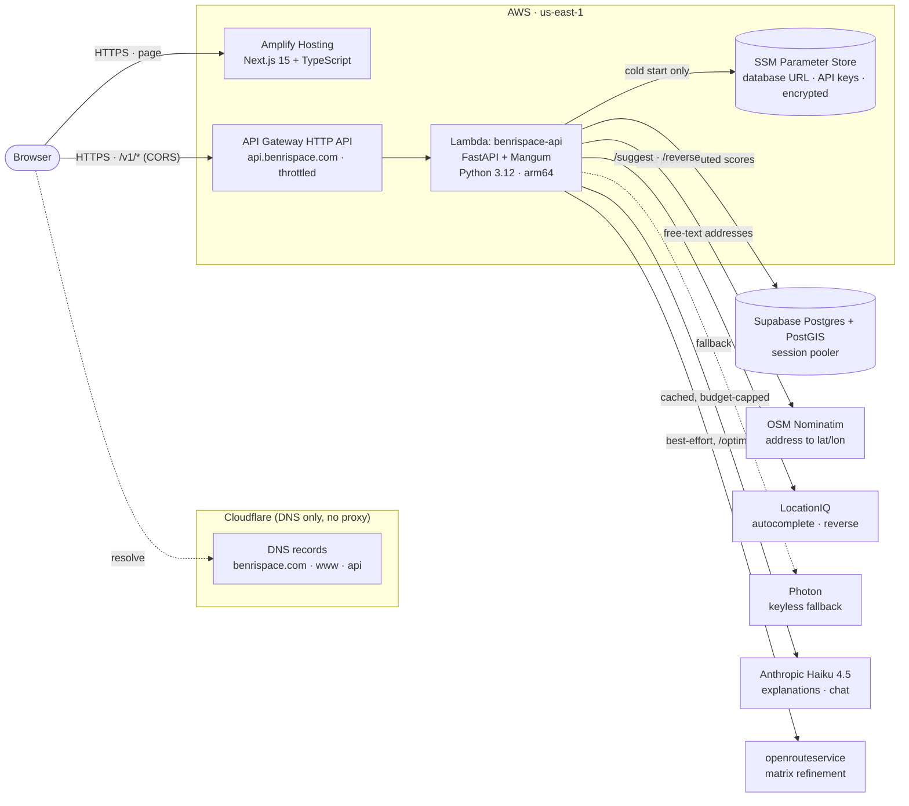
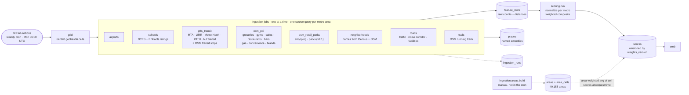
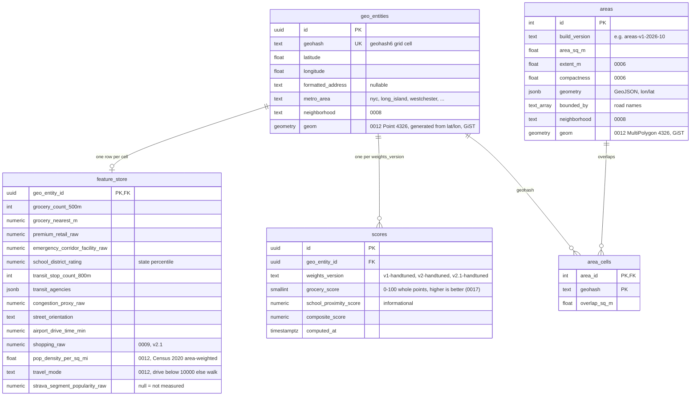

# BenriSpace — Architecture

BenriSpace scores New York metro locations on how convenient daily life is there
(groceries, transit, schools, parks, noise, airports...) using 13 factors. Scores
are **precomputed in batch** and served read-only, so live traffic never touches a
rate-limited third-party data API. The only live provider calls are address
search, reverse lookups, the optional routing refinement and the LLM, and all of
those are cached or capped.

Related documents: [../README.md](../README.md) (overview and quick start),
[SCORING.md](SCORING.md) (how scores are computed), [ROADMAP.md](ROADMAP.md)
(phases, status and decisions), [api.md](api.md) (API guide),
[data-sources.md](data-sources.md) (school data decisions).

Diagrams are [Mermaid](https://mermaid.js.org/) and render on GitHub.

**State as of 2026-10-04.**

- Production serves `v2-handtuned` (14 factors, 64,320 score rows; the Lambda runs
  `SCORING_WEIGHTS_VERSION=v2-handtuned`). Cutover was 2026-10-03.
- `v2.1-handtuned` (13 factors) is built. Migration 0009 is applied; the full
  ingestion for its new columns is in progress, and the cutover waits for owner
  approval.
- Neighborhood names (migration 0008) are applied. Areas are capped at 0.8 sq mi
  and there are 49,158 of them.
- Chat ("Ask Benri", `POST /v1/chat`) is in progress; migration 0010 is not
  applied yet.
- Valhalla routing precompute and the v3 scoring model are planned, not built.

## 1. Runtime: how a request is served

### API endpoints

All under `/v1`, defined in `contracts/openapi.yaml` (the source of the web
app's generated TypeScript types) and implemented in `api/main.py`. Full guide:
[api.md](api.md).

| Endpoint | Purpose |
| --- | --- |
| `GET /score` | Score for an address or coordinate (grid cell) |
| `GET /score/{id}/explanation` | Explanation of a score (AI-written when possible, rule-based otherwise) |
| `GET /area` | Score for the road-bounded area under a point (area-weighted average of its cells) |
| `GET /area/explanation` | Grounded explanation for the area under a point |
| `GET /suggest` | Address autocomplete (LocationIQ, Photon fallback) |
| `GET /reverse` | Readable address for a clicked point |
| `GET /places` | Named places (OSM POIs, NCES schools, transit stops) near a point |
| `GET /improve` | Deterministic "what would raise this score" suggestions with named places |
| `GET /similar` | Well-separated areas with a similar factor profile (SQL distance over z-scored factors) |
| `GET /map/cells` | Composite score per map cell for a chosen set of factors and weights |
| `GET /map/top` | Best, well-separated areas for the chosen factors (with neighborhood names) |
| `GET /isochrone` | Area reachable from a point in N minutes (walk, drive, rail) from the precomputed cell graph |
| `POST /triangulate` | Best locations for several commute anchors: real isochrone intersection / union, with the polygons |
| `POST /optimize` | Multi-destination optimizer: minimise weekly travel to work, a store brand, a gym... |
| `POST /chat` | "Ask Benri", a tool-using Haiku assistant (in progress) |
| `GET /map/scores` | The compact all-cells score file the browser scores from (see below) |
| `POST /chat/stream` | The same chat as server-sent events (`status` frames, then one `reply` or `error`) |

Behavior worth knowing:

- **Click-to-polygon.** `/area` finds the road-bounded polygon containing the
  point (`areas` + `area_cells`) and returns the area-weighted average of the
  overlapping cells' latest scores. It returns 404 when no polygon fits (over
  0.8 sq mi or 1.4 mi across, or none contains the point), and the web app then
  falls back to the single cell rectangle.
- **Point precision (experimental).** `?precision=point` on `/score` and `/area` scores
  the exact location on demand: one pipelined round trip (cell row plus one PostGIS
  statement over `places`), normalized with per-metro factor scales (`score_scales`,
  migration 0013, or computed once per Lambda instance). Falls back to the grid score on
  any error. See [SCORING.md](SCORING.md) A8.
- **Serving version.** Score reads prefer the Lambda's `SCORING_WEIGHTS_VERSION`.
  The code default is `v2-handtuned`; production sets it through the Terraform
  variable `scoring_weights_version`. Roll back by setting it to
  `v1-handtuned` and applying.
- **Neighborhood names.** `geo_entities.neighborhood` and `areas.neighborhood`
  (migration 0008); the API tolerates the columns being absent (the name is then
  null).
- **Isochrones and triangulate** run on the precomputed cell graph (section 6): Dijkstra in
  pure Python over `cell_graph` rows, polygon traced from the reached cells. With no routing
  data for an area they fall back to the straight-line circle.
- **Optimize** estimates minutes (straight line x 1.3 / mode speed) for every
  candidate cell, then refines the best candidates with openrouteservice for
  walk and drive (`common/ors.py`, best-effort, free tier). Transit stays an
  estimate.
- **Not on the request path:** scoring and ingestion. Requests read `scores`,
  `areas`, `area_cells`, `places` and the caches.

### The web app: local scoring, vector tiles, compare, streaming chat

- **Scoring in the browser.** The app downloads `GET /map/scores` once
  (`web/src/lib/scores/`): every cell's 13 sub-scores as bytes. The overall score
  is a weighted average, so the browser recomputes it exactly for any filter or
  importance change (`compositeAll`), recolours the map and ranks areas with no
  API call. While the file loads, or if it fails, the API endpoints answer as
  before.
- **Best areas, locally.** `localTop` (`lib/scores/topk.ts`) builds a max-heap of
  the cells in view (O(n)), pops the best, and checks the 1-mile spacing against
  the chosen cells in the 3 x 3 neighbouring squares of a grid hash, so selection
  is O(n + k log n) rather than a sort plus pairwise distances. The only API
  call left is for neighbourhood names, and it is made only when a ranked cell has
  not been named yet (`useMapData`); names are remembered per geohash.
- **Vector tiles (opt-in).** `scripts/build_tiles.py` turns the cell grid and the
  `areas_slim` polygons into one PMTiles file with tippecanoe (Docker, image from
  `scripts/tiles/Dockerfile`): layers `parents` (geohash-5, z5-9), `cells`
  (geohash-6, z10-13) and `areas` (z9-13), carrying geometry and ids only (`g` is
  the geohash). About 10 MB for 64,320 cells. With `NEXT_PUBLIC_PMTILES_URL` set at
  build time the map draws that archive (HTTP range requests, no tile server) and
  joins it to the score file by `g` through MapLibre feature-state
  (`components/map/usePmtilesCells.ts`): a filter change updates only the cells
  whose score moved. If a tile request fails the map falls back to GeoJSON cells.
  Unset (the default), nothing changes and the `pmtiles` library is not loaded.
  Owner steps to turn it on: create a Cloudflare R2 bucket with a public custom
  domain (or r2.dev) and a CORS rule allowing `GET`/`HEAD` with the `Range`
  header from the site origins; upload `build/tiles/benrispace.pmtiles` (cache
  `public, max-age=31536000, immutable` under a versioned name such as
  `benrispace-v1.pmtiles`); set `NEXT_PUBLIC_PMTILES_URL` in Amplify and redeploy.
  `next.config.ts` adds that origin to the CSP `connect-src` automatically. Rebuild
  the tiles only when the grid or area polygons change, not when scores do.
- **Static files on R2 (opt-in, `NEXT_PUBLIC_STATIC_URL`).** When set (for example
  `https://tiles.benrispace.com`, same CORS and CSP rules as the tiles URL), the app
  fetches `manifest.json` once per page (4 s timeout, `web/src/lib/static/manifest.ts`)
  and uses what it lists, each piece independently: `scores` (the same bytes as
  `GET /map/scores`, so `decodeScoreMatrix` is reused; `loadScoreMatrix` tries R2 first),
  `areaScores` (every road-bounded area's 13 sub-scores, centre, neighbourhood and metro,
  decoded by `lib/static/areaScores.ts`, binary-searched by area id) and `tiles` (the
  PMTiles archive; `NEXT_PUBLIC_PMTILES_URL` still wins when set). A missing manifest or
  piece, a network or CORS error, or a decode error silently means "ask the API as
  before"; with the variable unset nothing changes. Two things use the area file: a map
  click that lands in exactly one area (an invisible `areas` fill layer in the tiles is
  queried) shows that area's sub-scores and its overall score, computed with the same
  `cellComposite` as the cells for the selected filters, while `GET /area` loads, and the
  API's answer then replaces them; and similar areas are computed in the browser
  (`lib/static/similar.ts`, mirroring `api/similar.py`: same metro, per-metro z-scores,
  L2 over the 13 factors, overfetch then re-rank on selected factors, spread-out) with the
  API as fallback. Candidates are areas where the API's are grid cells, so ranks can
  differ slightly; the response shape is identical.
- **Compare places.** Pin 2-4 places (`useCompare`, kept in `sessionStorage`);
  `CompareDrawer` shows factor rings side by side, marks the best value in each
  row, shows how many points each place trails the best, and lists the three
  factors where the places differ most (`lib/compare.ts`).
- **Chat streaming.** `POST /chat/stream` runs the same tool loop (`run_chat`
  takes an optional `on_event` callback) and emits `status` frames ("Searching
  areas") while it works, then the validated reply. The reply text is not sent
  token by token: it is checked against the tool output first, and unvalidated
  tokens could show claims the check later replaces. The web client
  (`createApiClient({ chatStreamUrl })`) uses the stream only when
  `NEXT_PUBLIC_CHAT_STREAM_URL` is set and falls back to plain `/chat` when the
  stream is missing, not an event stream, or ends without a reply (a rate-limit or
  validation error is shown, not retried). API Gateway buffers responses, so the
  frames only arrive live through a Lambda function URL in `RESPONSE_STREAM`
  mode. `infra/chat_stream.tf` defines that second function (same zip, uvicorn
  behind the AWS Lambda Web Adapter via `api/run_stream.sh` and
  `api/stream_server.py`); it is off (`chat_stream_enabled = false`) and not
  applied. Owner steps: remove `uvicorn` from `EXCLUDED_DEPENDENCIES` in
  `scripts/build_lambda.sh`, set `chat_stream_enabled = true` and
  `chat_stream_adapter_layer_arn`, apply, then set `NEXT_PUBLIC_CHAT_STREAM_URL`
  to the `chat_stream_url` output plus `v1/chat/stream`. The function URL is
  public and shares the per-visitor daily limit and monthly budget with `/chat`.

## 2. Data pipeline: how scores are produced

- The weekly workflow (`.github/workflows/ingestion.yml`) runs the grid, then
  the sources one after another (airports, schools, gtfs_transit, osm_poi,
  osm_retail_parks, neighborhoods, roads, trails), then `scoring.run` and
  `api.scorefile` (persists the compact score file). It runs sequentially because every job updates different
  columns of the same `feature_store` rows and a job's transaction holds those
  row locks until commit; in parallel they hit Postgres' 2-minute
  `statement_timeout`. Scoring runs even if one source failed (stale values
  persist; the red job still surfaces the failure). The `schools` job needs the
  `.[schools]` pip extra (shapely, pyshp).
- **Each job queries a source once per metro area** and computes per-cell results
  locally, never one request per cell. The shared Overpass client retries a fast
  502/503/504 with backoff and lets a slow one reach the bbox-splitting that
  roads, trails, osm_poi and osm_transit use.
- **Jobs degrade independently**: an Overpass timeout fails one job and its
  `ingestion_runs` row, not the pipeline. Strava is not configured, so the route
  popularity signal comes from mapped OSM trails alone.
- **Writes** go through one shared DB layer (`common/db.py`) that wraps every
  connection in psycopg3 pipeline mode (this dropped airport ingestion from more
  than 3 minutes and zero rows to 5.9 s for all 64,320 rows). Bookkeeping writes
  use a separate connection so a failure can always be recorded.
- **Transit coverage.** MTA, LIRR, Metro-North, PATH (public Trillium feed) and
  NJ Transit (open official rail and bus downloads, no key or account) are
  separate per-agency jobs inside `gtfs_transit`. `ingestion/osm_transit.py`
  adds OpenStreetMap stops as a pseudo-agency to fill gaps (CT, Westchester and
  Long Island buses, areas near PATH).
- **Schools.** NCES EDGE locations for NY/NJ/CT plus EDFacts district
  proficiency (2018) from the Urban Institute Education Data Portal, converted to
  within-state percentiles. See [data-sources.md](data-sources.md).
- **Trails lessons.** An early tag selection captured ordinary sidewalks
  (`highway=footway` without excluding `footway=sidewalk|crossing`); excluding
  them server-side cut NYC from 1,173,871 to 326,522 segments. Bucket-index
  lookups expand rings instead of falling back to a brute-force scan (the
  fallback took 921 s for 4,029 cells).
- **Areas** are rebuilt by hand (`python -m ingestion.areas.build --source region
  --write`; Overpass tiles are cached, fetching needs `--allow-network`). They
  are a face of the network of secondary-and-above roads closed at the coast,
  cut to the limits in `ingestion/areas/limits.py`: at most 0.8 sq mi and 1.4 mi
  across, about 0.75 mi tile cuts, slivers under 0.02 sq mi merged into a
  neighbour when the caps allow. Apply migration 0006 before `--write`. Product
  rule: "your 10-minute radius dictates your life", so an area is about a
  square mile at most. Secondary roads and above are hard barriers (owner
  decision).
- **Neighborhood names** (`ingestion/neighborhoods.py`): Census TIGER/Line county
  subdivisions say which town a point is in (a label never crosses a river or
  state line); OSM `place=neighbourhood|suburb|quarter` nodes supply the
  names, giving labels like "Park Slope, Brooklyn" or "Montclair, NJ".
- **Places** (`places` table): one row per named amenity (OSM POIs, NCES schools,
  GTFS stops). Each job owns its `source` and replaces it wholesale. Powers
  `/places` and `/improve`.
- **Similar areas**: `/similar` computes, in SQL, the L2 distance between per-metro
  z-scored factor scores over the target's metro (one scan of about 25,000 rows, tens of
  milliseconds), spread out geographically and re-ranked on the selected factors. No
  embedding column or vector index is stored (the HNSW index alone was 46 MB).
- Scores are relative within each metro cohort in v1/v2/v2.1, and area scores are
  averages of about 0.6 x 0.4 mi cells, so small areas share similar scores
  until per-polygon scoring exists.

## 3. Data model

Other tables: `ingestion_runs` (per-job status log: source, status, rows
affected, error), `places` (named amenities, 0004), `llm_cache` and `llm_usage`
(0005), `chat_usage` (0010), and `road_segments` (0012, not applied: `osm_id`, `highway`, `name`, `is_emergency_route`, `geom` LineString 4326 with a GiST index; major roads and mainline rail). `places.geom` (Point 4326, GiST) is added by 0012 too. The geometry columns are not used by any API query yet.

`feature_store` has dozens of raw columns; only a representative set is shown. A
`null` raw value always means "not measured yet", never "zero".
`area_cells.geohash` is a plain text join to `geo_entities.geohash`, not a
foreign key. `contracts/schema.sql` is the full schema for a fresh database; each
migration is mirrored into it.

### Migrations

Migrations live in `contracts/migrations/` and are run by hand against production
after review (additive and idempotent, so old code keeps working).

| # | Adds | Status |
| --- | --- | --- |
| 0002 `v2` | v2 feature_store columns (restaurants, bars, brands, noise-corridor facilities, school rating) | applied 2026-10-02 |
| 0003 `areas` | `areas`, `area_cells` | applied 2026-10-02 |
| 0004 `places` | named `places` table | applied 2026-10-03 |
| 0005 `llm` | `llm_cache`, `llm_usage` | applied 2026-10-03 |
| 0006 `area_shape` | `areas.extent_m`, `areas.compactness` | applied 2026-10-03; written by the area build (49,158 areas at 0.8 sq mi) |
| 0007 `embeddings` | pgvector extension, `scores.embedding vector(14)`, HNSW index | applied 2026-10-03; 64,320 embeddings written by `scoring.embeddings` |
| 0008 `neighborhoods` | `neighborhood` on `geo_entities` and `areas` | applied 2026-10-04 |
| 0009 `v2_1` | v2.1 feature_store and scores columns (imperial units) | applied 2026-10-04 |
| 0010 `chat` | `chat_usage` (per-visitor daily message count) | not applied; the API skips the limit while the table is missing |
| 0022 `routing` | `routing_meta`, `cell_travel`, `cell_graph`, `routing_hubs`, `cell_hubs`, `rail_matrix` (about 7 MB for the metro; smallint arrays, deci-minutes) | not applied; written by `python -m ingestion.routing.run` |
| 0012 `density_postgis` | PostGIS; `feature_store.pop_density_per_sq_mi` and `travel_mode`; `geom` on `geo_entities`, `places`, `areas` with GiST indexes; `road_segments` | not applied; written by `ingestion.density` and `ingestion.road_segments` |

Migrations 0016 to 0021 (storage compaction, not applied; apply order in the storage model
below; 0015 is the point-scoring places index and 0014 `areas_slim`):

| # | Does | Destructive |
| --- | --- | --- |
| 0016 `drop_embeddings_similar` | drops `scores.embedding`, its HNSW index and `similar_cells` | yes (data no longer used) |
| 0017 `scores_compact` | sub-scores to smallint, composite to real, drops `scores.id` (primary key becomes `(geo_entity_id, weights_version)`) and two redundant indexes; table rewrite | yes (rounds scores) |
| 0018 `geo_entities_trim` | drops the unused `geom` column and GiST index, `created_at`, `updated_at` | yes |
| 0019 `score_files` | `score_files` table holding the gzipped compact score file | no |
| 0020 `feature_store_imperial_expand` | adds `*_nearest_ft`, `*_count_1600ft`, `*_count_half_mi`, `*_count_1mi`, `school_avg_rating_1mi` (smallint / real) and backfills them | no (adds about 40 MB transiently) |
| 0021 `feature_store_imperial_contract` | drops the 27 metric columns and narrows other numeric columns to real / smallint in one rewrite | yes, irreversible |

## 4. Scoring engine

Full method in [SCORING.md](SCORING.md). Summary:

| Version | `weights_version` | Factors | State |
| --- | --- | --- | --- |
| v1 | `v1-handtuned` | 11 | retired (rows deleted) |
| v2 | `v2-handtuned` | 14 (12 toggleable + premium retail and trail popularity as underlying signals) | **live in production** |
| v2.1 | `v2.1-handtuned` | 13, every one a user-facing pill | built; full ingestion in progress; cutover pending owner approval |
| v3 | `v3-timeaccess` | 13+ | planned: absolute time-to-access curves, mode by density |

`scoring/engine.py` holds the per-version category specs and weights (`DEFAULT_WEIGHTS`,
`V2_1_WEIGHTS`); `scoring/run.py` writes versioned rows and nulls stale columns;
`scoring/similarity.py` holds the similarity dimensions and z-score helpers.

## 5. AI layer

- **Model.** Anthropic Haiku 4.5 (`claude-haiku-4-5`) only, through
  `common/llm.py`. Decided 2026-10-03.
- **RAG, not fine-tuning.** The data changes constantly, and retrieval
  constrains the model to what is in the evidence. A hallucinated "great coffee
  shop nearby" is a trust-breaking failure for this product.
- **Grounding.** The model sees only a JSON evidence packet (the user's
  priorities, sub-scores, nearest-feature distances, how each factor compares
  with the metro). Output is validated; on any failure the rule-based
  explanation (`api/explain.py`) is returned. Explanations: `api/ai_explain.py`,
  prompt version `expl-v2`. Chat (`api/chat.py`) can only call read-only tools
  that run our own code in-process; structured results and sources are built
  deterministically from tool outputs, and the free-text reply passes a grounding
  validator (numbers and capitalised proper nouns must appear in tool outputs or
  the user's messages) or is replaced by a deterministic summary.
- **Budget.** `llm_cache` stores validated responses keyed by a hash of the
  evidence (entity, weights_version, scores, prompt version) so an area is paid
  for once. `llm_usage` logs every paid call; month-to-date spend at or above
  `LLM_MONTHLY_BUDGET_USD` (default $5) switches to rule-based text. Chat adds a
  per-visitor daily message cap (15, table `chat_usage`) and returns 503 without
  an API key.
- **Evaluation scripts:** `scripts/eval_explanations.py`, `scripts/eval_chat.py`.

## 6. Routing and optimizer

### Precompute (`ingestion/routing/`, Wave 4)

Run by hand or by a batch job (needs the `routing` extra: Pandana, numpy; **not** in the Lambda
bundle). Nothing here runs on the request path.

| Product (table) | What | How |
| --- | --- | --- |
| Amenity minutes (`cell_travel`) | For every cell, minutes to the 1st-3rd nearest place of each of the 14 categories, in the cell's own travel mode (walk at or above 10k people / sq mi, drive below) | One multi-source Pandana search per category per tile (contraction hierarchy), read at each cell's snapped node |
| Cell graph (`cell_graph`) | Minutes from each cell to its 8 neighbours, for walk and for drive | `shortest_path_lengths` between snapped cell centres, never faster than a straight line |
| Hub matrices (`routing_hubs`, `cell_hubs`) | Drive minutes to the 3 nearest airports (JFK, LGA, EWR, TEB, HPN, ISP, SWF, BDR) and rail stations | One arterial-only backbone network for the region (motorway to secondary), cell access leg at 15 mph |
| Train times (`rail_matrix`) | Ride minutes between every rail station pair | Connection Scan over GTFS (subway, LIRR, Metro-North, PATH, NJ Transit rail), weekday, three AM-peak departures, median; stations within 300 m linked by walking |

**Tiling.** The grid is cut into tiles of whole cells (walk 10 x 8 cells, drive 30 x 20). A tile fetches
its network with a pad as wide as the search cap (walk 3 km; drive 6 km of full network plus 45 km of
arterials only), computes, commits and drops everything, so peak memory is set by the tile and not
by the region. A 5 hour radius is more tiles, not more memory. The OSM source
(`ingestion/routing/network.py`, `fetch_network`) is the one swap point: public Overpass is fine for the
current metro but rate limits and 504s under bulk load (responses are cached on disk and retried),
so a 5 hour radius should read a Geofabrik extract instead.

**Units and caps.** Minutes are stored as deci-minutes in `smallint[]`, -1 meaning "not within the cap"
(walk 30 min, drive 45 min, hubs 120 min). Layout is recorded in `routing_meta`. Walk is 3 mph;
drive is OSM maxspeed (or highway-class defaults) x 0.8, free flow.

### Request time

- **Isochrones** (`api/isochrone.py`, `api/reach.py`, `api/routing_data.py`): pandana, osmnx and numpy do
  not fit the Lambda bundle (50 MB zip) and an OSM graph cannot be loaded in the 29 s cap, so the road
  network is pre-folded into the cell graph. A request loads the `cell_graph` rows around the origin
  (one indexed bounding-box query), runs Dijkstra in pure Python, and traces the cells into a polygon
  (boundary tracing + two rounds of corner cutting; no shapely, no PostGIS). Resolution is one cell
  (0.58 x 0.38 mi). `ingestion/routing/isochrone.py` builds the street-level version offline (reachable
  nodes to buffered union or concave hull) for QA and special cases.
- **Triangulate** ranks the precomputed scores inside the intersection or union of the anchors' cell sets.
- **Optimize** (`api/optimize.py`): Weiszfeld geometric-median seed, exact lower-bound pruning,
  stored times in place of estimates (cell_travel, cell_hubs, rail matrix), then openrouteservice
  refinement of what is left (walk and drive). Estimates remain the fallback: straight line x 1.3 /
  mode speed (walk 3 mph, drive 25 mph + 2 min parking, transit 15 mph).
- **Address train trip** = walk to a station within 1.5 mi (straight line x 1.3 at 3 mph) + `rail_matrix`
  ride + walk from a station near the destination, best of up to 6 stations at each end.

### Measured (laptop, Jersey City + Hoboken sample, walk, 2026-10-05)

Tiles of 10 x 8 cells (about 6 x 8 km) plus a 3 km pad held 100k to 220k nodes each: 21 s, 236 s and 96 s
per tile, 490 to 940 MB peak RSS, almost all of it Overpass download time (the public server was
returning 504s; compute is a few seconds per tile). Train matrix: 933 stations, 273k connections,
fetch 4.5 s + build 0.2 s + 2,800 scans 12 s, 190 MB. A walk isochrone request over the stored graph
takes about 2 ms of Dijkstra plus one query; a 45 minute rail isochrone about 30 ms.

### Scaling to a 5 hour radius

Work grows with cells (about 25x the current 64k at 5 h), not with memory. Drive-time cell graphs at
that range need coarser levels (a geohash5 graph for trips beyond about 90 minutes) because a request
would otherwise load hundreds of thousands of rows; `reach.MAX_MINUTES` is where that cap lives.

## 7. Delivery: how code and infrastructure ship

- **Branches.** All work happens on `dev-benrispace`; `main` changes only through
  a pull request, because merging to `main` triggers the Amplify build (every
  push) and `deploy-api.yml` (changes to `api/`, `common/`, `scoring/`,
  `pyproject.toml`). `ci.yml` diffs against `main` and runs the Python and/or web
  checks only for changed areas; **`ci-ok`** is the single status to require.
  Batching several changes into one PR means one deploy instead of many.
- **Terraform** (`infra/`, plus `infra/bootstrap/` for the S3 state bucket)
  manages every AWS resource and every Cloudflare DNS record: Lambda
  (`python3.12`, arm64), API Gateway HTTP API (throttled 10 rps, burst 20), ACM
  certificates, the `api.benrispace.com` custom domain, Amplify app and domain,
  SSM parameters, the GitHub OIDC provider and deploy role, and a $10/month
  budget alert. `terraform apply` is deliberately manual (AWS SSO). Not yet
  applied: the Valhalla EC2 instance.
- **No long-lived AWS keys** exist anywhere: CI uses OIDC, the developer uses SSO.
  The database URL and API keys live only in SSM; Terraform writes placeholders
  and never sees the real values.
- **Operational lessons.**
  - Amplify built from a private repo needs the console's "Migrate to our GitHub
    App" step; a personal token alone broke builds once revoked. For a rebuild:
    create the app with a short-lived token, migrate immediately, revoke the
    token.
  - GitHub issues the OIDC `sub` claim with immutable IDs
    (`repo:owner@id/repo@id:ref:...`); the IAM trust matches that form
    (`github_owner_id`, `github_repository_id`), which also resists rename or
    transfer impersonation.
  - Use the Supabase **Session pooler** connection string: the direct host is
    IPv6-only and fails from IPv4-only places (this sandbox, GitHub runners).
  - The `execute-api.amazonaws.com` address is disabled
    (`disable_execute_api_endpoint = true`); `api.benrispace.com` is the only
    entry point.
- The API zip is cross-built for Linux arm64 / Python 3.12 from any host
  (`scripts/build_lambda.sh`), so local and CI builds match.

## 8. Hosting, domain and costs

- **Domain** `benrispace.com` (registered 2026-09-28 at Cloudflare Registrar).
  DNS stays at Cloudflare (the registrar requires its nameservers); Terraform
  manages every record as DNS-only so AWS certificates validate end to end.
  `benrispace.com` and `www` go to Amplify; `api.benrispace.com` goes to API
  Gateway.
- **Why AWS, everything.** Switched from GCP on 2026-09-29, and the frontend moved
  off Firebase the same day. Not a cost decision (free tiers are comparable); AWS
  has broader market and resume recognition, which matters because the project
  doubles as a portfolio piece. The original reason for GCP (co-locating
  Valhalla) turned out not to require it.
- **Why Lambda + API Gateway.** Lambda scales to zero and its always-free
  allowance (1M requests + 400,000 GB-s per month) covers this traffic. A bare
  Function URL does not support custom domains, so API Gateway HTTP API (about
  $1 per million requests) sits in front.
- **Why Next.js on Amplify.** React/TypeScript is the most in-demand frontend
  stack; Amplify gives git-push deploys and per-branch previews while keeping the
  stack single-cloud.
- **Storage.** Supabase free tier (Postgres + PostGIS; see the storage model below; it was about 180 MB of 500 MB
  used after the v2 scores); no separate vector database.
- **Costs.** Close to $0/month: domain (about $12-20 a year), Supabase and Lambda
  free tiers, GitHub Actions free minutes, free data sources (OSM, GTFS, NCES,
  EDFacts). Real items: API Gateway pennies, Amplify per build-minute
  (about $0.01) and GB served, Terraform state in S3 (effectively $0), and the
  LLM, capped at about $5/month. AWS restructured its free tier for new
  accounts in 2025 (starting credits plus a set of always-free offers such as
  Lambda); EC2 for Valhalla would draw down credits then bill normally, so budget
  a few dollars a month if it is ever run continuously. A card on file is an AWS
  signup requirement, and the $10 budget alert guards against surprises.
- **Request limits** exist to protect that cost budget: API Gateway throttles at
  10 rps with bursts of 20 across all callers; per-user tiers come in Phase 4
  (see [ROADMAP.md](ROADMAP.md)).

## 9. Key design decisions

- **Precompute, don't compute live.** Scoring is batch; the API is a thin read
  layer. Latency is about 0.2 s warm and cost near zero.
- **One grid, many independent jobs.** Every source writes into the same geohash
  grid, so sources can fail, retry and be added without touching each other.
- **Contract first.** `contracts/openapi.yaml` and `contracts/schema.sql` were
  fixed before code that depends on them; the web types are generated from the
  spec.
- **Infrastructure as code, single cloud.** Everything on AWS in Terraform; DNS at
  Cloudflare because the registrar requires it.
- **Honest missing data.** Unmeasured factors are `null` end to end: the scorer
  re-weights around them and the UI shows "No data" instead of 0.
- **GitHub Actions for orchestration.** Enough for a weekly cadence; Airflow or
  Dagster only if multiple metros with different refresh cadences justify it.
- **Imperial units on the wire and in the UI** (feet and miles; the API's newer
  columns are imperial). Older raw columns are still metres, and renaming them is
  planned (see [ROADMAP.md](ROADMAP.md)).

## 10. Storage model and the 5-hour radius

Measured on production on 2026-10-05 (read-only queries): database 469 MB of the 500 MB
free tier, 456 MB of it in `public`.

| Table | Rows | Total | Heap | Indexes | Per row (total) |
| --- | --- | --- | --- | --- | --- |
| `scores` (2 versions) | 128,640 | 181 MB | 80 MB | 101 MB (HNSW 46, cover 22, unique 15, pkey 9, geo 5, version 4) | 1,406 B |
| `areas` | 49,158 | 105 MB | 92 MB (`geometry` jsonb 26.5, `geom` 14.9) | 12 MB | 2,142 B |
| `feature_store` | 64,320 | 68 MB | 63 MB | 5 MB | 1,054 B |
| `places` | 101,749 | 39 MB | 16 MB | 23 MB (trigram 6.5, unique 5.2, category/lat/lon 4.6, geom 4.2) | 384 B |
| `area_cells` | 163,903 | 36 MB | 16 MB | 21 MB | 222 B |
| `geo_entities` | 64,320 | 19 MB | 10 MB | 9 MB | 290 B |
| `spatial_ref_sys` (PostGIS) | 8,500 | 7 MB | | | |
| everything else | | under 1 MB | | | |

Bytes per cell today (cells = geo_entities + feature_store + scores for both versions):
about 2,750 B. Areas cost about 2,900 B each with `area_cells`.

### What the compaction saves (local copy of production's shape, 64,320 cells)

| Change | Before | After |
| --- | --- | --- |
| Delete `v2-handtuned` scores (`scripts/delete_scores.py`) | 181 MB | about 90 MB |
| 0016 + 0017: no embedding or HNSW, smallint scores, no `id`, 2 indexes dropped | about 90 MB per version (production, bloated) | about 15 MB per version (227 B per cell) |
| 0018: geo_entities | 19 MB | about 16 MB (about 248 B per cell) |
| 0020 + 0021: narrower feature_store types | 68 MB | about 50 MB (about 775 B per cell, estimated from the 27 percent measured locally) |
| Stored score file (0019) | 8 s cold rebuild | one 300 KB row |
| Areas to `areas_slim` (0014, owned by the area build) | 142 MB (`areas` + `area_cells`) | about 25 to 30 MB (estimate) |

Projected production total after all of it: about 469 MB to about 160 MB with `areas_slim`
(about 276 MB if `areas` stays), leaving 220 to 340 MB of room.

### How big is a 5-hour radius?

From Census 2020 county land area and 2023 population estimates (county centroids within a
great-circle radius of Manhattan; today's six metro boxes cover 29 counties, 10,472 sq mi
and 23.4 million people):

| Radius | Land (sq mi) | x today | Population | x today |
| --- | --- | --- | --- | --- |
| 100 mi | 17,159 | 1.6 | 27.4 M | 1.2 |
| 150 mi | 40,021 | 3.8 | 34.5 M | 1.5 |
| 200 mi | 69,280 | 6.6 | 47.5 M | 2.0 |
| 250 mi (about 5 h at highway speeds) | 108,442 | 10.4 | 56.8 M | 2.4 |
| 300 mi | 143,583 | 13.7 | 63.9 M | 2.7 |

So the 5-hour radius is about 10x the land and 2.4x the people, not 30 to 50x (that figure
was a whole-US estimate). Cell-count tables grow with land, `places` with population, and
road-bounded areas with land unless rural land is left unsubdivided. Today's grid is
rectangles with water included (64,320 cells for 10,472 sq mi of land, about 1.75 cells per
land cell of 0.287 sq mi), so pruning water cells alone cuts a rebuild by about 40 percent.

Projection at 250 mi, with the compacted per-row costs above:

| Plan | Cells | Cell tables (1,250 B each) | Places (about 270,000 x 384 B) | Areas | Total |
| --- | --- | --- | --- | --- | --- |
| A. Everything at geohash6, land only | about 378,000 | 472 MB | 104 MB | about 245 MB (`areas_slim`, one per 0.56 sq mi of land) | about 820 MB, does not fit |
| B. Tiered grid: geohash6 where county density is 200 or more people per sq mi, geohash5 (about 9.2 sq mi) below | about 166,000 | 207 MB | 104 MB | about 40 MB (areas only in the dense tier) | about 350 MB, fits with 30 percent headroom |
| C. B plus raw features kept off the database (below) | about 166,000 | 117 MB | 104 MB | about 40 MB | about 260 MB |
| D. A on a paid database tier | about 378,000 | | | | Supabase Pro (8 GB, about $25 a month) |

What fits in 500 MB, in order of leverage:

1. Apply the compaction above (needed even for today's data: 469 MB is one bad ingestion
   from the limit, because an ingestion rewrite briefly doubles a table).
2. Prune water cells from `ingestion/grid.py` and tier the grid by density (plan B). The
   biggest lever: 2.3x fewer cells than plan A.
3. Keep `feature_store` raw values out of the serving database. The API reads only about 16
   of its columns (nearest distances for explanations, school info, density). Ingestion can
   write the full table as Parquet to Cloudflare R2 (free 10 GB, no egress fees) or CI
   artifacts and keep a slim serving table of about 120 B per cell (plan C).
4. If traction justifies it, move to Supabase Pro instead of tiering: plan A fits with 8 GB
   and removes the 7-day pause and the 500 MB cliff. Cloudflare R2 would also hold PMTiles
   for the cell grid (Wave 2) and the stored score file.

Not worth more effort: `places` indexes (23 MB) are 60 percent of its size, but each serves a
query (trigram brand search, upsert key, KNN). When migration 0015 (`places_category_geom_gist`)
is applied, `places_category_lat_lon_idx` (4.6 MB) becomes redundant and can be dropped.
`spatial_ref_sys` (7 MB) can be trimmed to the SRIDs in use.

### Owner commands for the compaction (production, in this order)

1. `python scripts/delete_scores.py --version v2-handtuned` (dry run), then `--yes`; then
   `vacuum full scores;` in the SQL editor. (Frees about 90 MB; needed headroom for the
   rewrites below.)
2. Deploy the API / ingestion built from this branch (it no longer reads `embedding`, and
   reads and writes the imperial feature_store columns through `common/feature_columns.py`).
   Deploy after step 3 for the feature columns, before step 4 for `embedding`.
3. Apply `0020` (adds and backfills the imperial columns), then deploy, then run the
   ingestion and scoring job once.
4. Apply `0016`, `0017`, `0018`, `0019` (each in its own run), then `python -m api.scorefile`.
5. When the new code has run cleanly: apply `0021` (irreversible).
6. Optional: `vacuum full geo_entities;`.

### Cold starts

`import api.lambda_handler` takes about 290 ms (measured with `python -X importtime`):
FastAPI 144 ms, `api.main` itself 18 ms, `api.point_score` 62 ms (mostly psycopg), mangum 31
ms. The Anthropic SDK, httpx and shapely are already imported lazily (`common/lazy.py`,
`common/llm.py`), so there is nothing large left to defer; the remaining cold-start cost was
the 8 s score-file rebuild, now stored in `score_files`. Lambda SnapStart is a separate,
untested option.

### Edge caching and alarms (Terraform, not applied)

`infra/edge_cache.tf` proxies `api.benrispace.com` through Cloudflare and caches GETs that
send `Cache-Control` (off unless `enable_edge_cache = true`). `infra/alarms.tf` adds
CloudWatch alarms (Lambda errors, p95 duration, throttles, API Gateway 5xx) to an SNS topic
emailing `budget_alert_email`.
