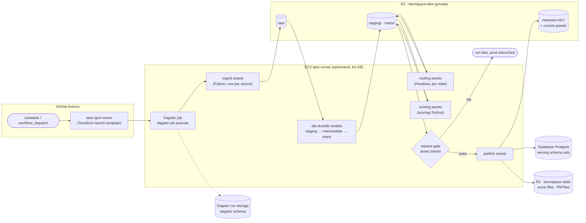

# BenriSpace — Data Platform (target architecture)

Status: **proposed**, owner-approved direction 2026-10-18. Nothing here is built yet. Today's
pipeline is described in [ARCHITECTURE.md](ARCHITECTURE.md) section 2; this document is where it
is going and the order to get there.

## 1. Goals

1. **No production compute on the owner's Mac.** Ingestion, routing, scoring, tiles and
   publishing all run on ephemeral cloud machines started by a schedule or a button. The Mac
   only runs small development slices (one county).
2. **Data quality gates.** A run that produces bad data never reaches production. Checks are
   declared next to the data they test and block publishing when they fail.
3. **Scale to the whole US** without the serving database growing with it: build data lives in
   object storage, Postgres holds only what the live API queries.
4. **One reproducible, versioned release per run**, with rollback by pointer.
5. Stay close to today's costs (see section 9).

Non-goals: real-time data, streaming, a warehouse service (Snowflake, BigQuery), Kubernetes.

## 2. Decisions

| Area | Choice | Why | Instead of |
| --- | --- | --- | --- |
| Orchestration | **Dagster (OSS)** | Models the pipeline as data assets with lineage, partitions (one per state), asset checks and retries per partition. dbt models appear as assets natively (`dagster-dbt`). | GitHub Actions job chains (no lineage, no partial retries); Airflow (task-centric, heavier to host) |
| Transforms | **dbt Core + dbt-duckdb** | SQL models with tests, contracts and docs; DuckDB reads and writes Parquet on R2 directly, so there is no warehouse to pay for. | Python-only transforms writing to Postgres |
| Compute engine | **DuckDB** (with `spatial` and `httpfs`) | A single machine handles US-scale Parquet; spatial joins and H3 are extensions. | Postgres as the build engine (row locks, statement timeouts, the reason today's jobs run one at a time) |
| Build storage | **Cloudflare R2, private bucket `benrispace-lake`**, Parquet / GeoParquet | 10 GB free, no egress fees, S3-compatible so DuckDB and boto3 work unchanged. | Supabase tables (500 MB free tier) |
| Runner | **Ephemeral EC2 spot instance** registered as a just-in-time GitHub Actions runner | Enough memory for routing (64 GB), costs cents per run, terminates itself. Self-hosted minutes do not count against the private repo's 2,000 free Actions minutes. | The owner's Mac; GitHub-hosted runners (2 vCPU and about 7 GB on a private repo, too small for routing) |
| Data quality | **dbt tests + model contracts**, **Dagster asset checks**, a **release gate** | Each layer catches a different failure (section 6). | Ad hoc sanity prints |
| Serving | Postgres + PostGIS (serving tables only) and static files on R2 (as today) | The API's live queries need PostGIS and `pg_trgm`; everything else is a file. | Moving serving to DuckDB (no concurrent low-latency server story on Lambda yet) |
| Scoring code | **Stays Python** (`scoring/`), run as a Dagster asset over Parquet | The curves and normalization are tested Python; porting them to SQL adds risk with no gain. dbt prepares their inputs and shapes their outputs. | Rewriting scoring in dbt SQL |

## 3. Target architecture



The API, the web app and R2 static delivery stay as they are. What changes is how their data is
produced and loaded.

## 4. Storage layout (`benrispace-lake`)

```
raw/<source>/<state>/dt=YYYY-MM-DD/*.parquet      source data as fetched, never edited
staging/<model>/<state>/*.parquet                 typed, cleaned, imperial units (dbt)
marts/<model>/<state>/*.parquet                   cell features, area features, places (dbt)
routing/<state>/run=<id>/*.parquet                cell_travel, cell_graph, hubs (Python)
scores/<version>/<state>/run=<id>/*.parquet       area_scores, cell scores (Python)
releases/<release_id>/manifest.json               every file in the release, with sha256 and row counts
releases/<release_id>/checks.json                 every check result for the release
releases/current                                  one line: the live release_id
```

- `release_id` is `YYYYMMDD-<git sha7>`, so every release names the code that built it.
- `raw/` is append-only. Rebuilding any later layer from `raw/` is reproducible.
- Lifecycle rules: keep `raw/` for 90 days, keep the last 6 releases, delete the rest. This keeps
  the bucket inside 10 GB at US scale (estimate: 3-5 GB per release before compression,
  roughly a third of that as Parquet).
- `benrispace-static` stays the public bucket behind `tiles.benrispace.com`. The lake is never
  public.

## 5. The pipeline in Dagster

### Partitions

Every asset that grows with land or population is partitioned by **state** (`NY`, `NJ`, `CT`
first). A spot interruption or a failed source re-runs one state, not the country. Assets that
are national by nature (airports, the Census density table) are unpartitioned.

### Assets

| Layer | Asset (examples) | Built by | Replaces today |
| --- | --- | --- | --- |
| Ingest | `raw_osm_extract`, `raw_gtfs_<agency>`, `raw_nces_schools`, `raw_edfacts`, `raw_census_density`, `raw_tiger_cousub`, `raw_airports` | Python (`ingestion/` fetch functions) | the `fetch` half of each `ingestion/*.py` module |
| Staging | `stg_pois`, `stg_transit_stops`, `stg_schools`, `stg_density`, `stg_roads`, `stg_trails` | dbt | the parsing and unit conversion inside each module |
| Grid | `cells` (geohash6 today, H3 later: section 8) | dbt + Python | `ingestion/grid.py`, `ingestion/density.py` |
| Intermediate | `int_cell_features`, `int_places` | dbt | `feature_store`, `places` writes |
| Areas | `areas` | Python (`ingestion/areas/`) | `ingestion.areas.build` (rare, manual asset) |
| Routing | `road_networks`, `cell_travel`, `cell_graph`, `cell_hubs`, `rail_matrix`, `area_reach` | Python (`ingestion/routing/`) | `ingestion.routing.pbf`, `.run`, `.reach` on the Mac |
| Scoring | `area_scores`, `cell_scores` | Python (`scoring/area_run.py`) | `scoring.area_run --write` on the Mac |
| Marts | `serving_places`, `serving_cells`, `serving_areas`, `score_file_input` | dbt | shapes the API reads |
| Publish | `release_manifest`, `serving_tables`, `static_score_files`, `pmtiles` | Python | `publish_static.py`, `copy_routing.py`, `copy_areas_slim.py`, `build_tiles.py` |

### Refactor rule for existing modules

Each `ingestion/*.py` module splits into a pure `fetch(state) -> DataFrame` (or a file written to
`raw/`) and its current DB writer. The Dagster asset calls `fetch`; the DB writer stays until the
cutover (section 10) so the weekly job keeps working during the migration.

### OpenStreetMap at US scale

Today each job queries Overpass once per metro. That does not scale to 50 states and is unkind to
public servers. The target reads **Geofabrik state extracts** (`.osm.pbf`) once per run into
`raw_osm_extract` and extracts POIs, roads, trails and transit stops from that file (DuckDB
`spatial`'s `ST_ReadOSM`, or osmium, which routing already uses). Overture Maps places
(GeoParquet, readable by DuckDB in place) is worth evaluating as a second POI source; it would be
a data-source decision for the owner.

### Schedules

| Job | Assets | Cadence |
| --- | --- | --- |
| `refresh` | ingest → dbt → routing → scoring → gate → publish | weekly (Mondays), replaces both today's weekly job and the monthly Mac run |
| `routing_networks` | `road_networks` only | monthly (networks change slowly; reused by `refresh`) |
| `areas_rebuild` | `areas` and downstream | manual |

Routing is the slowest step. If a weekly `refresh` with routing is too slow or too costly once
more states exist, routing moves to its own monthly job and `refresh` reuses the latest routed
tables, which is today's behavior made automatic.

### Where Dagster state lives

Dagster runs as a CLI process on the runner (`dagster job execute`); there is no always-on
Dagster server. Run and event storage is a `dagster` schema in Postgres so run history survives
the ephemeral machine, with a retention job that deletes event logs older than 30 days to protect
the free tier. To browse runs and lineage, the owner runs `dagster dev` locally against that
storage (UI only, no compute). Dagster+ (hosted) is the upgrade if an always-on UI and alerting
are wanted; check its pricing before choosing it.

## 6. Data quality

Three layers, each catching a different failure.

### Layer 1 — dbt tests and contracts (every model)

- **Staging:** `not_null` and `unique` on keys, `accepted_values` on categories, `relationships`
  from facts to cells. Source freshness on each `raw/` source (`warn_after: 8 days`,
  `error_after: 15 days`).
- **Range tests** (custom generic tests in `dbt/tests/generic/`): distances in mi between 0 and
  the factor's cap, densities non-negative, latitude and longitude inside the state's bounding
  box, sub-scores 0-100 or `null`.
- **Null rules:** a missing measurement is `null`, never 0. A generic test fails a model where a
  measured column contains 0s in more than its expected share of rows.
- **Model contracts** (`contract: {enforced: true}`) on every mart, so a renamed or retyped
  column fails the build instead of breaking the API.

### Layer 2 — Dagster asset checks (Python assets)

- Ingest: row count per state within ±20 % of the previous successful run (a GTFS feed that
  silently comes back empty fails here).
- Routing: every populated cell reaches at least one neighbor; walk and drive pair counts within
  ±10 % of the previous run; no travel time is negative or above the stepper caps.
- Scoring: every area has a score row; share of `null` per factor within ±5 points of the
  previous release.
- dbt tests surface as asset checks too (`dagster-dbt`), so one view shows every check.

### Layer 3 — the release gate (blocks publish)

Runs over the candidate release before any write to production:

1. **Golden places** (`dbt/seeds/golden_places.csv`): about 50 hand-picked addresses with
   expected score bands, for example Midtown Manhattan groceries 85-100, a rural CT hilltop
   transit 0-15. Any place outside its band blocks.
2. **Drift against the live release:** median overall score moves by more than 3 points, or more
   than 10 % of areas move by more than 15 points, blocks. Smaller moves are reported as
   warnings in `checks.json`.
3. **Size budget:** the serving tables must fit the Postgres plan with 2x headroom for the swap
   (section 7).

Blocking checks fail the run and leave production on the previous release. Warnings are written
to `checks.json` and the run summary. Overriding a block is a deliberate re-run with
`--allow-drift` and a reason, recorded in the manifest.

## 7. Publishing and serving

- **Static files:** score files and PMTiles are built from the release and uploaded to
  `benrispace-static` content-hashed, as `publish_static.py` does today; the manifest is updated
  last, so the web app switches atomically.
- **Postgres:** the API's tables move from `public` to a `serving` schema. Publishing loads the
  release into `serving_next` (DuckDB's `postgres` extension or `COPY`), builds indexes, then in
  one transaction renames `serving` to `serving_prev` and `serving_next` to `serving`. The API's
  `search_path` points at `serving`. Rollback is the reverse rename, or re-publishing an older
  release.
- The swap needs room for two copies of the serving tables. On the 500 MB free tier that is
  tight; a per-table swap is the fallback until the plan grows.
- **Approval:** the publish step runs in the GitHub `production` environment with the owner as
  required reviewer, so no production write happens without an explicit approval (this keeps the
  existing rule in CLAUDE.md). The runner only gets production credentials inside that step.
- Writing `releases/current` is the last step of a successful publish.

## 8. Grid and growth

The density-tiered grid (fine cells where county density is 200 or more people per sq mi, coarse
elsewhere, water pruned) is required for US scale regardless of tooling
([ARCHITECTURE.md](ARCHITECTURE.md) section 10). The platform makes a move from geohash to **H3**
practical: equal-area cells at every latitude, native multi-resolution (res 8 in cities, res 6-7
rural) and cheap neighbor lookups, all available in DuckDB's `h3` extension. H3 also touches the
API, the score file and the tiles (`h3-js` in the browser), so it is its own decision and phase,
validated against today's scores on NY, NJ and CT before any rollout.

## 9. Cost

| Item | Estimate |
| --- | --- |
| EC2 spot runner (64 GB, x86) | about $0.15-0.30 per hour; a 2-3 hour weekly run is a few dollars a month |
| R2 lake + static | free up to 10 GB, then $0.015 per GB-month; no egress fees |
| Supabase | free tier for NY/NJ/CT; Pro (8 GB, about $25/month) for US scale |
| GitHub Actions | CI only on hosted runners; pipeline minutes run on the self-hosted runner |
| Dagster, dbt Core, DuckDB | free (open source) |

Prices are estimates; check current spot prices and plans before relying on them. A $10 AWS
budget alert already exists; add a spot-instance max price and a hard `timeout-minutes` on the
workflow so a hung run cannot bill for hours.

## 10. Migration plan

Each phase ships on its own and leaves production working. Exit criteria must hold before the
next phase starts.

| Phase | Work | Exit criteria |
| --- | --- | --- |
| 0. Foundations | `benrispace-lake` bucket, spot runner launch template and IAM in Terraform; `pipeline/` package with Dagster definitions and an empty dbt project; CI runs `dbt build` on a fixture sample in DuckDB and loads the Dagster definitions | A no-op Dagster job runs on the spot runner from `workflow_dispatch` and the instance terminates itself |
| 1. Lake in parallel | Ingest assets write `raw/`; dbt staging and intermediate models rebuild `feature_store` and `places` as Parquet for NY/NJ/CT; today's weekly job keeps running | Parquet `int_cell_features` matches prod `feature_store` (same cells, values equal within rounding) |
| 2. Quality | dbt tests, contracts, asset checks, golden places, drift gate | Gate passes on a good run and blocks on a deliberately broken one (empty GTFS feed, shifted coordinates) |
| 3. Routing and scoring off the Mac | Routing and scoring assets on the runner; candidate releases written to `releases/` but not published | Candidate `area_scores` match prod v2.2 within 1 point for 99 % of areas |
| 4. Cutover | `serving` schema migration, publish assets with approval, retire `ingestion.yml`, `copy_routing.py`, `copy_areas_slim.py` and the monthly Mac run | Two consecutive weekly releases published by the pipeline; rollback rehearsed once |
| 5. OSM from extracts | Replace Overpass queries with Geofabrik extract parsing | Feature parity on NY/NJ/CT (same check as phase 1) |
| 6. Grid and expansion | Density-tiered grid (H3 if approved); add states in batches (Northeast first); Supabase Pro when the size budget says so | Each new state passes the gate; serving size within plan |

## 11. Repository layout

```
pipeline/
  benri_pipeline/
    definitions.py        Dagster Definitions: assets, checks, jobs, schedules, resources
    partitions.py         state partitions
    resources.py          R2 (S3), DuckDB, Postgres resources from env
    assets/
      ingest.py           wraps ingestion/ fetch functions
      routing.py          wraps ingestion/routing/
      scoring.py          wraps scoring/
      publish.py          release manifest, serving load and swap, static files, tiles
    checks/               asset checks and the release gate
  dbt/
    dbt_project.yml
    profiles.yml          dbt-duckdb profile, R2 credentials from env
    models/staging/ · models/intermediate/ · models/marts/
    seeds/golden_places.csv
    tests/generic/        range and null-share tests
infra/pipeline.tf         lake bucket, runner launch template, IAM, budget guard
.github/workflows/pipeline.yml   start runner, run the Dagster job, publish with approval
```

`ingestion/`, `routing/` and `scoring/` stay where they are and remain importable; `pipeline/`
orchestrates them. New Python dependencies (`dagster`, `dagster-dbt`, `dbt-duckdb`, `duckdb`) go
in a `pipeline` extra in `pyproject.toml`, never in the Lambda bundle.

## 12. Risks

| Risk | Mitigation |
| --- | --- |
| Spot interruption mid-run | State partitions and asset-level retries; Dagster re-runs only what failed |
| Pandana or tippecanoe memory on large states | Routing already runs per tile; size the instance from the largest state measured in phase 3 |
| Silent bad data from a source | Source freshness, row-count deltas and golden places (section 6) |
| Dagster run storage growing in the free-tier database | 30-day event log retention; move to Dagster+ or a separate small database if it still grows |
| Two copies during the serving swap on a 500 MB plan | Size budget check; per-table swap fallback; Supabase Pro at US scale |
| Credentials on an ephemeral machine | Short-lived IAM role for AWS; R2 and database secrets from SSM, fetched at start, production database credentials only in the approved publish step |
